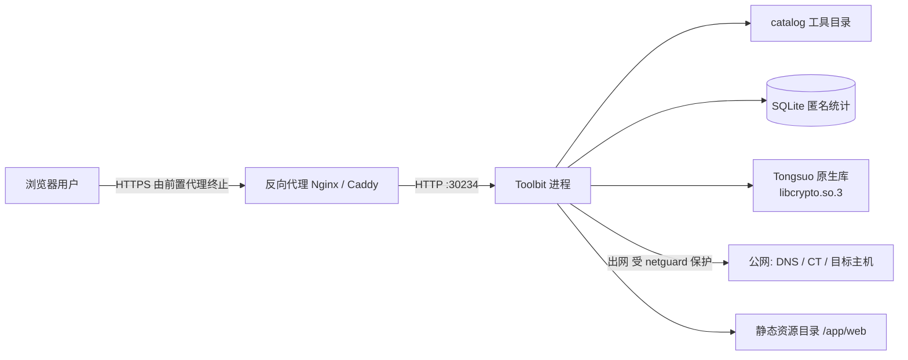
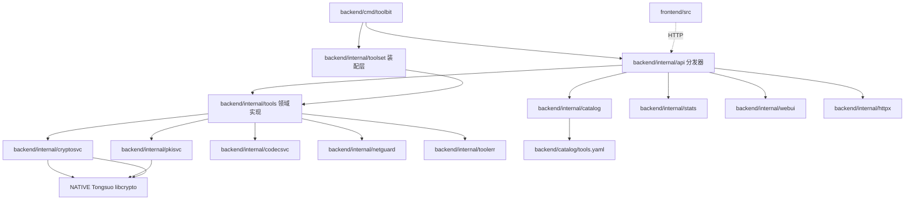
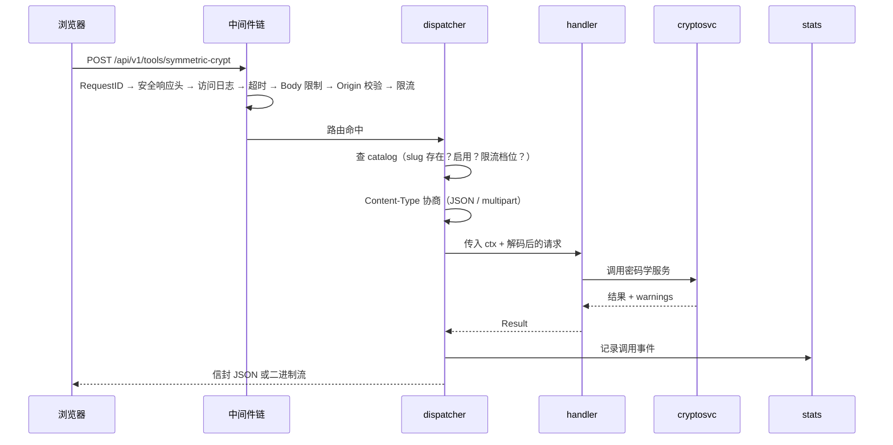
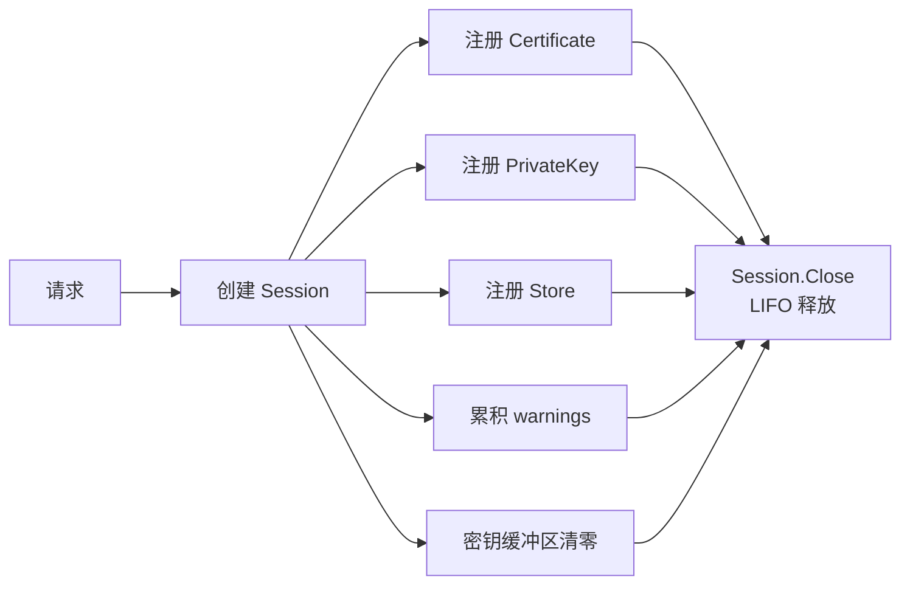
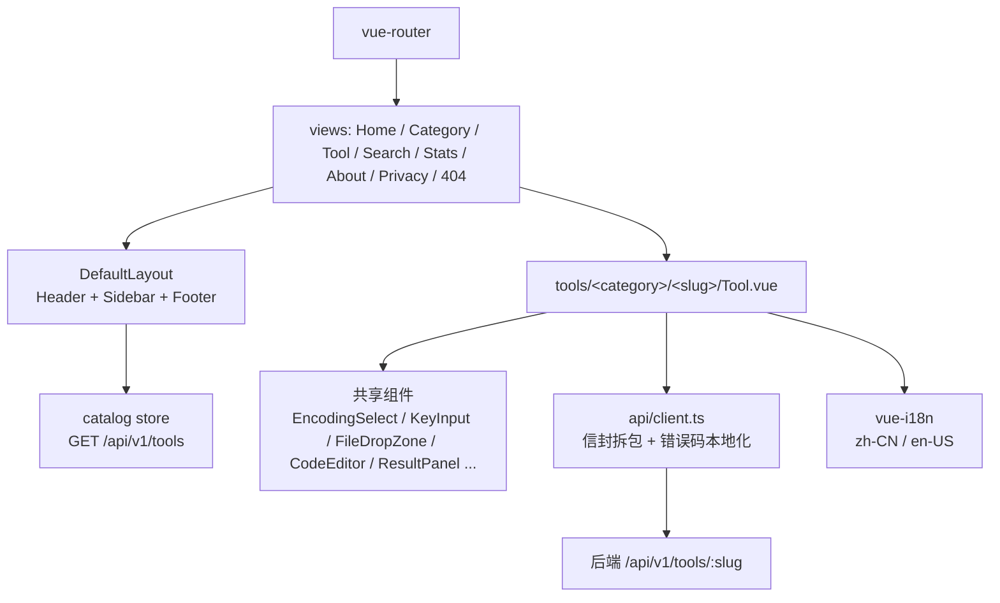
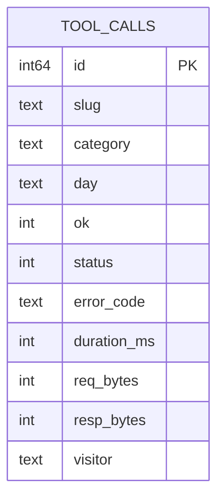

# 架构总览

> 状态：Stable ｜ 适用版本：v0.7.0 ｜ 最后更新：2026-10-29

本文描述蓝云工具箱的整体结构、运行时行为与关键决策。**先读目标与非目标，再读分层，最后看决策清单。**

---

## 1. 目标与非目标

### 1.1 目标

- 提供 **97 个** IT / 密码学工具，覆盖国密、PKI、编码、格式化、文本、数据、系统、网络、文档 11 个领域。
- 密码学结果**以 Tongsuo 为唯一真源**，避免多实现导致的互通问题。
- 全部计算在服务端完成，前端只负责交互与展示。
- 单进程部署：API 与静态资源同端口，容器内不运行 Nginx。
- 无账号体系；不存储用户输入。

### 1.2 非目标（明确不做）

| 不做 | 原因 |
| --- | --- |
| 浏览器本地密码学计算 | 会与 Tongsuo 产生两套实现与结果差异；v1 只保留 `websocket-test` 一个协议例外 |
| 用户账号 / 收藏云端同步 | 收藏与最近使用只存本地；服务端不识别用户 |
| 在线支付 / 会员 / 广告 | 与工具站定位无关 |
| 内置 TLS 终止 | 交由前置反向代理处理，容器只监听明文 HTTP |
| 通用任务队列 / 分布式部署 | 单进程足够；统计写入用内存队列 + 批量落盘 |

---

## 2. 系统上下文



**要点**

- 进程同时承担 API 与静态资源两个角色，监听 `30234`。
- Tongsuo 以 cgo 方式链接，运行时通过 ELF `rpath` 定位 `/opt/tongsuo/lib64`。
- 出网仅限 6 个在线工具（`ssl-check` 走 WebSocket 流式端点），
  全部经过 `backend/internal/netguard`。

---

## 3. 目录结构与依赖方向

### 3.1 仓库目录结构

仓库顶层是**两个独立构建单元**加**一组共享资产**：

```text
Toolbit/
├── backend/                    ← 后端：独立 Go 模块
│   ├── go.mod                  module github.com/blue-cloud-net/Toolbit/backend
│   ├── go.sum
│   ├── cmd/
│   │   └── toolbit/            进程入口、装配、优雅退出
│   ├── catalog/                工具目录（SSOT 载体）
│   │   ├── embed.go            //go:embed tools.yaml
│   │   └── tools.yaml          工具元数据唯一事实来源
│   └── internal/               全部后端实现，禁止被外部导入
│       ├── api/                HTTP 分发器与端点
│       ├── buildinfo/          版本信息（ldflags 注入）
│       ├── catalog/            目录解析与校验
│       ├── codecsvc/           编码归一化
│       ├── cryptosvc/          密码学原语层（可 import tongsuo-go）
│       ├── pkisvc/             密钥与 PKI 层（可 import tongsuo-go）
│       ├── httpx/              响应信封、中间件、requestId
│       ├── netguard/           出网防护
│       ├── stats/              匿名统计
│       ├── toolerr/            错误码注册表
│       ├── toolset/            工具装配层（汇总各分类 Definitions）
│       ├── tools/              各领域工具实现
│       └── webui/              静态资源与 SPA 回退
│
├── frontend/                   ← 前端：独立 pnpm 项目
│   ├── package.json
│   ├── vite.config.ts          构建与 manualChunks（按工具拆 chunk）
│   ├── uno.config.ts           原子化 CSS 与设计令牌映射
│   ├── vitest.config.ts        单测配置
│   └── src/
│       ├── api/                后端通信唯一入口（统一拆信封）
│       ├── components/         layout / discovery / tool 三组共享组件
│       ├── composables/        useToolRun 等组合式函数
│       ├── i18n/               词条装配与错误码本地化
│       ├── layouts/            DefaultLayout
│       ├── locales/            zh-CN/ 与 en-US/（含 tools/<slug>.json）
│       ├── router/             路由表（路由级懒加载）
│       ├── stores/             catalog / prefs
│       ├── styles/             tokens.css / base.css / element-overrides.css
│       ├── tools/              <category>/<slug>/{index.ts,Tool.vue,example.ts}
│       ├── types/              与后端 DTO 对齐的类型
│       └── views/              路由级页面组件
│
├── docs/                       文档（standards / api / templates）
├── scripts/                    文档与一致性校验脚本
├── deployments/                Dockerfile / docker-compose.yml / .env.example
│
├── Makefile                    跨前后端的工程入口
├── .golangci.yml               Go 静态检查规则
├── .editorconfig               缩进与编码约定
└── README.md / AGENTS.md / CHANGELOG.md / LICENSE
```

> **目录约定**
>
> - `backend/` 与 `frontend/` **互不依赖**：后端不 import 前端产物，前端不 import 后端源码。
> - 后端 Go 模块根在 `backend/`，因此 import 路径为 `github.com/blue-cloud-net/Toolbit/backend/internal/...`。
> - 工具目录 YAML 位于 `backend/catalog/tools.yaml`，**不**在仓库根：
>   `//go:embed` 不能引用上级目录，SSOT 必须与 `embed.go` 同目录。
>   该文件由文档与前端工具链按需读取，**不构成第二份副本**。
> - `backend/internal/` 是 Go 的可见性边界：`backend/internal/...` 只允许被 `backend/` 内的包导入。

### 3.2 依赖方向



**规则**

- 依赖单向向下，`api → tools → {cryptosvc, pkisvc} → tongsuo-go`。
- `backend/internal/cryptosvc` 与 `backend/internal/pkisvc` 是**仅有的两个**
  允许 `import tongsuo-go` 的包；前者负责密码学**原语**，
  后者负责密钥与 **PKI 领域**（生成与格式、X.509、JWK、PKCS 容器）。
- 两个密码学层的**句柄类型互不通用**：各自持有原生句柄、都必须显式释放；
  跨层只传 PEM / DER 等表示层数据。
- `backend/internal/toolset` 是**装配层**：汇总各分类的 `Definitions()`，
  进程入口与 API 测试共用，避免两处各维护一份清单。
- `backend/internal/httpx` 不依赖任何领域包，可被任意层使用。
- `backend/internal/catalog` 只读 YAML，不认识工具实现。
- 前端与后端之间**只**通过 HTTP 契约耦合，无源码级依赖。

---

## 4. 后端分层

### 4.1 分发器（`backend/internal/api`）

分发器有**两条**通道，按 catalog 的 `transport` 分流：

| 通道 | `transport` | 请求 | 响应 |
| --- | --- | --- | --- |
| JSON | `json` | `application/json` | 统一信封 |
| multipart | `multipart` | `multipart/form-data` | **二进制流**，不套信封 |

两条通道共用同一套校验顺序（见 `api/dispatch.go` 的注释）与同一套
Session / 超时 / 限流 / 统计机制。

单一入口 `POST /api/v1/tools/{slug}`，处理顺序固定：



中间件链由外向内：`Recovery` → `RequestID` → `SecurityHeaders` → `AccessLog` → `Timeout` → `BodyLimit` → `OriginCheck` → `RateLimit` → `Stats`。

`RateLimit` **只作用于 `/api` 分组**：首屏会并发拉取几十个带内容 hash 的 chunk，若全局限流会直接 429。

### 4.2 工具实现（`backend/internal/tools`）

工具实现有两种形态：

| 形态 | 接口 | 适用 |
| --- | --- | --- |
| JSON | `Handler(ctx, Request) (Result, error)` | 绝大多数工具 |
| multipart | `MultipartHandler(ctx, MultipartRequest) (MultipartResult, error)` | 文件类工具 |

multipart 形态的请求绑定**流式**的 `multipart.Reader`；
文件部分**必须**是最后一个 part（读到文件就无法回头取字段）。

按领域分包：`crypto`、`keys`、`cert`、`encoding`、`formatting`、`text`、`data`、`system`、`network`、`documents`。

每个 handler 的职责**只有三件事**：

1. 解码输入（JSON 结构体 / multipart 表单）并做**字段级**校验；
2. 调用 `cryptosvc` / `pkisvc` / `codecsvc` / `netguard` 的服务；
3. 编码响应（DTO）。

handler **不做**算法实现，**不**直接接触 Tongsuo，**不**自己拼错误码。

### 4.3 加密服务层（`backend/internal/cryptosvc`）

密码学**原语**层。对外暴露按能力划分的**包级函数**：

| 能力 | 函数 | 说明 |
| --- | --- | --- |
| 摘要 | `Digest` | SM3 / MD5 / SHA 系列 |
| MAC | `MAC` | HMAC-SM3 / SHA 系列 |
| 对称 | `SymEncrypt` / `SymDecrypt` | SM4 / AES；ECB / CBC / CTR / OFB / CFB / GCM |
| 签名 | `Sign` / `Verify` | SM2 / RSA / ECDSA / Ed25519 / Ed448 |
| 非对称加解密 | `AsymEncrypt` / `AsymDecrypt` | SM2 / RSA |
| 密钥协商 | `ECDHSharedSecret` / `ECDHDerive` | 曲线协商 + HKDF 派生 |
| 随机 | `RandomBytes` | CSPRNG |
| 密钥加载 | `LoadPrivateKey` / `LoadPublicKey` | PEM / DER / base64 / hex |
| 文件容器 | `NewTBFCWriter` / `NewTBFCReader` | `TBFC` 分块 GCM 容器（流式） |

> PKI 能力（证书、CSR、CRL、OCSP、PKCS#7 / #12、JWK）在 v0.5.0 – v0.6.0 交付，
> 届时在 `pkisvc` 新增对应函数。

**能力缺口**：`tongsuo-go` 尚未提供的算法（DES / 3DES / ECIES 等）**不自研兜底**，
一律登记到 [upstream/tongsuo-go-issues.md](upstream/tongsuo-go-issues.md) 并跳过。

**生命周期模型**：`cryptosvc.Session` 是每个请求的「句柄作用域」，
经 `ctx` 传递给 handler，**不**改变 `tools.Handler` 的签名。



- 释放顺序与注册顺序相反，幂等。
- `priv.Public()` **不注册**：它与私钥共享底层句柄，关闭私钥即释放。
- `x509.CertificateRequest` 没有公开 `Close`，只能靠 finalizer，**禁止跨请求持有**。
- 私钥 PEM 源缓冲在加载后立即清零。
- 服务不缓存任何密钥 / 证书对象；每请求重新加载。
- Session 累积的警告在分发器**写响应之前**合并进 `meta.warnings`。

**并发与限额**

- 全局信号量：重操作并发 ≤ 2，由 `Session.Acquire(ctx)` / `Session.Release(operation)` 使用。
- cgo 调用**不可中断**：超时后请求返回 `504`，但底层工作仍会跑完；
  此时记录一条 orphan 日志并释放信号量。
- 流式处理每 1 MB 检查一次 `ctx`。

---

## 4.4 PKI 服务层（`backend/internal/pkisvc`）

密钥与 **PKI 领域**层：密钥生成与格式、X.509、JWK、PKCS 容器。

| 能力 | 函数 | 说明 |
| --- | --- | --- |
| 密钥生成 | `Generate` | RSA / SM2 / EC / Ed25519 / Ed448 / X25519 / X448 |
| 格式转换 | `Convert` | PKCS#1 / PKCS#8 / SPKI / DER / PEM 互转 |
| 密钥解析 | `Inspect` | 算法、类型、位数、曲线、公钥指纹、RSA 参数 |
| 密钥运算 | `EncryptPrivateKey` / `DecryptPrivateKey` / `ChangePassphrase` / `ExtractPublicKey` | 口令加解密与改密 |
| 配对检测 | `Match` | 私钥 ↔ 公钥 / 证书；依据公钥 SPKI 指纹 |
| JWK / XML | `JWKFromPEM` / `PEMFromJWK` / `XMLFromPEM` / `PEMFromXML` | RFC 7517 与 .NET `RSAKeyValue` |
| X.509 证书 | `LoadCertificate` / `ParseCertificates` / `Describe` / `Fingerprints` / `CheckValidity` | 主体 / 签发者 / 有效期 / 扩展 / 指纹 / 有效性 |
| PEM ↔ DER | `SplitPEM` / `NormalizeToDER` / `ConvertPEMDER` | 块拆分、类型过滤、格式互转 |
| 证书签名请求 | `ParseCSR` / `VerifyCSR` | 主体 / SAN / 公钥 / 扩展 / 自签名校验 |
| 证书链 | `OrderChain` / `SplitChain` | AKID → SKID 排序与链拆分 |
| 链验证 | `VerifyChain` | 逐层验证、域名匹配、结构化错误项 |
| 链修复 | `RepairChain` | 从中间证书与受信任根里补链 |
| 吊销列表 | `ParseCRLInfo` | 签发者 / 有效期 / 吊销条目 |
| ASN.1 | `ParseASN1` / `HexDump` | DER 展开为 TLV 树与十六进制转储 |
| CSR 生成 | `CreateCSR` | `NewEmptyCertificateRequest` 分步构建后签名 |
| 证书签发 | `IssueCertificate` | `NewCertificate` 分步构建（避免「已签名锁」） |
| CRL 签发 | `CreateCRL` | `NewCRLBuilder`；原因码白名单校验 |
| 吊销判定 | `LoadRevocationList` / `CheckRevocation` | 先验签后判定；过期 CRL 一律拒绝 |
| OCSP | `CreateOCSPRequestDER` / `ParseOCSPResponseDER` | 请求生成与响应解析（含可选验签） |
| PKCS#12 | `PackPKCS12` / `ParsePKCS12` / `ChangePKCS12Password` | 容器打包、解析与改密 |
| PKCS#7 | `BuildPKCS7` / `ExtractPKCS7` | **仅证书袋**（上游能力边界） |

**与 `cryptosvc` 的边界**

- `cryptosvc` 负责**运算**（摘要 / MAC / 对称 / 非对称 / 签名）；
  `pkisvc` 负责**结构与格式**（密钥、X.509、容器）。
- 两层的句柄类型**互不通用**：各自持有原生句柄、都必须显式释放；
  跨层只传 PEM / DER 等表示层数据。
- `pkisvc` 的**公开签名不出现** `tongsuo-go` 的类型，
  以免 tools 层被迫 import `tongsuo-go` 而破坏边界。
- X.509 / CSR / CRL / ASN.1 能力已在 v0.5.0 落到本层；
  证书签发、CRL 签发、吊销判定、OCSP 与 PKCS 容器在 v0.6.0 补齐。

---

## 5. 静态资源与 SPA 回退

前端构建产物由 Go 进程以目录方式提供，**不引入 Nginx**。

| 路径 | 行为 |
| --- | --- |
| `/assets/*` | `Cache-Control: public, max-age=31536000, immutable`（文件名带内容 hash） |
| `index.html` 及其他 | `Cache-Control: no-cache`（发版后必须回源校验） |
| 未命中且**无扩展名** | 回退到 `index.html`（history 路由） |
| 未命中且**有扩展名** | `404`（缺失 chunk 返回 JSON 风格错误，不返回 HTML） |
| 含 `..` 或非法路径 | `404`（`fs.ValidPath` 校验） |
| `/api/*` 未命中 | 返回 **JSON 404**，绝不回落到 `index.html` |

目录缺失时返回 `503` 并提示检查 `TOOLBIT_WEB_ROOT`，避免运维面对一串 404。

---

## 6. 工具目录（catalog）

`backend/catalog/tools.yaml` 是**工具元数据的唯一事实来源**：

```yaml
- slug: symmetric-crypt
  category: crypto
  order: 3
  name: 对称加解密
  nameEn: Symmetric Encryption
  enabled: true
  transport: json        # json | multipart | websocket | client
  rateClass: standard    # light | standard | heavy | file | network
  maxBodyBytes: 4194304
  timeoutMs: 15000
  sensitive: true
  requiresNetwork: false
  autoRun: false
  wide: false
  i18nKey: tools.symmetric-crypt
```

它同时驱动：

- 后端：限流档位、Body 上限、超时、工具启用状态；
- 前端：菜单、首页分类卡、搜索、工具页参数区；
- 文档：`docs/tools.md` 与 `docs/api/tools/*.md` 的覆盖率校验；
- 统计：分类维度。

> `transport: client` 表示该工具**没有后端端点**（仅 `websocket-test`）。

---

## 7. 前端架构



**要点**

- 工具组件**静态登记**在 `frontend/src/tools/index.ts`，slug → 组件是编译期映射；目录数据只提供展示元信息。
- 路由级懒加载 + 按分类切 chunk；初始 JS 目标 < 250 KB（gzip），单工具 chunk < 40 KB。
- 工具页统一为**单列上下**布局：输入 → 参数 → 运行 → 结果；视口 ≥1024 时自动变为左右分栏，分隔条可拖拽调整比例（比例记忆在 `localStorage`）。
- 所有工具提供「填入示例」；示例数据放在各工具的 `example.ts`。
- 主题跟随系统，浅色优先；主色 12 组预设，每组提供明暗两套令牌（不做任意取色）。
- 收藏与最近使用只存 `localStorage`；工具输入**一律不落本地存储**。

---

## 8. 统计与隐私



- 表：单表 `tool_calls`，按 `day` 分区查询。
- `visitor = HMAC-SHA256(salt || ip || day)[:16]`，**不存原始 IP**，且盐值按日轮换 → 单日可聚合计数，跨日无法关联。
- 写入：内存 channel + 批量落盘（2 秒 / 100 条触发）；队列满则**丢弃**该事件，不阻塞请求。
- 不记录：输入内容、请求体、User-Agent 原文、错误详情。
- 保留期默认 90 天，每日清理一次。
- SQLite 位于 `/app/data/toolbit.db`，通过卷挂载持久化。

---

## 9. 容器与部署

### 9.1 镜像构建

多阶段 Dockerfile（`deployments/Dockerfile`）：

| 阶段 | 基础镜像 | 产出 |
| --- | --- | --- |
| `tongsuo` | `golang:1.25-bookworm` | 编译 Tongsuo 8.4.0 → `/opt/tongsuo`（`--libdir=lib64 shared enable-ntls`） |
| `frontend` | `node:22-alpine` | Vite 产物 → `frontend/dist`（运行时落到 `/app/web`） |
| `backend` | `golang:1.25-bookworm` | cgo 链接后产生 `/out/toolbit` |
| `runtime` | `debian:bookworm-slim` | 二进制 + `/app/web` + Tongsuo 运行库 |

**关键点**

- Tongsuo 以 `-Wl,-rpath,/opt/tongsuo/lib64` 链接，runtime 阶段复制**同一路径**，因此**不需要** `LD_LIBRARY_PATH`。
- 禁止在镜像级 `ENV` 设置 `LD_LIBRARY_PATH` / `LD_PRELOAD`：会遮蔽系统 OpenSSL，导致 `curl`（healthcheck 用）因符号版本不匹配而启动失败。
- runtime 基础镜像与 builder 同一 Debian 代次，保证 glibc 一致。

### 9.2 硬化

- 非 root 运行（UID 10001）。
- 只读根文件系统 + `tmpfs` 挂载 `/tmp`；数据卷挂 `/app/data`。
- `cap_drop: ALL`；`no-new-privileges`。
- 暴露端口 `30234`；`HEALTHCHECK` 调用内置子命令 `toolbit healthcheck`（打 `/readyz`）。

### 9.3 网络形态

- 默认**明文 HTTP**：`TOOLBIT_TRUST_PROXY=false`，限流按直连来源 IP。
- 公网暴露时应在前方加 TLS 反向代理（示例见 [deploy.md](deploy.md)）。
- 开启 `TOOLBIT_TRUST_PROXY=true` 时，**必须**同时限制可信代理网段，否则限流会被代理 IP 归并。

---

## 10. 关键决策

> 本节吸收原本独立的 ADR 记录。每条给出**背景 / 决策 / 代价**。

### D1 单一分发端点

- **背景**：工具数量已达 97 个，若各注册一组路由，路由表、统计埋点、限流、超时、文档都要逐项重复。
- **决策**：所有工具走 `POST /api/v1/tools/{slug}`，按 `Content-Type` 协商 JSON / multipart；流式工具另有 `GET /api/v1/tools/{slug}/stream`。
- **代价**：无法用 HTTP 语义直接表达「读」与「幂等」；工具元信息必须外挂 catalog。

### D2 catalog 作为单一事实来源

- **背景**：工具的分类、限额、限流档位、启用状态若分散在代码各处，必然漂移。
- **决策**：`backend/catalog/tools.yaml` 内嵌进二进制，同时驱动后端行为、前端渲染与文档校验。
- **代价**：新增工具要改 YAML + 注册表 + 前端登记三处；由 CI 校验三者一致。

### D3 全部工具后端执行

- **背景**：浏览器本地实现更快、更私密，但会与 Tongsuo 产生两套结果，破坏「以铜锁为真源」的承诺。
- **决策**：除 `websocket-test`（浏览器原生协议客户端）外，全部走服务端。
- **代价**：密钥类工具的输入会离开浏览器，必须在 UI 明确提示。

### D4 错误双层结构

- **背景**：前端需要稳定可本地化的错误标识，同时需要人类可读的兜底文案。
- **决策**：HTTP 状态表达大类，`error.code` 表达具体原因，`error.params` 承载可插值参数；`message` 只作兜底。
- **代价**：错误码注册表需要维护唯一性与 i18n 覆盖，由 CI 校验。

### D5 SM2 默认密文格式

- **背景**：SM2 密文的 `C1C3C2` / `C1C2C3` 顺序与 `04` 前缀在各家实现中不统一，是联调失败的首要原因。
- **决策**：输出默认 `C1C3C2` + `04` 前缀 + 裸格式（`asym.EncryptWithOrder`）；输入自动识别 DER / 裸格式与两种顺序（`asym.Format` 互转）。
- **代价**：与部分只接受 DER 的系统对接需显式切换。

### D6 SQLite 而非外部数据库

- **背景**：统计需求简单（按日聚合计数），无账号、无强一致要求。
- **决策**：`modernc.org/sqlite` 纯 Go 驱动，避免第二个 cgo 依赖与额外服务。
- **代价**：单写入者；高并发写入需靠批量与丢弃策略削峰。

### D7 rpath 而非 LD_LIBRARY_PATH

- **背景**：Tongsuo 与系统 OpenSSL 的符号版本不同，遮蔽会导致 `curl` 等系统程序崩溃。
- **决策**：编译期写入 `-Wl,-rpath`，运行时复制到同一路径；镜像内**不设** `LD_LIBRARY_PATH`。
- **代价**：二进制不可搬迁到其他路径（可接受，容器内路径固定）。

### D8 不内置 TLS

- **背景**：证书续期是运维职责，不应绑死在应用镜像里。
- **决策**：进程只监听明文 `30234`；部署文档给出 Nginx / Caddy 反代示例。
- **代价**：公网暴露时若不自行加 TLS，密钥类输入会以明文过网。文档与 UI 提示中会明确风险。

### D9 加密服务层隔离

- **背景**：Tongsuo 的句柄有明确的释放语义（幂等 Close、别名共享、finalizer 不可靠），散落在 handler 里极易泄漏或重复释放。
- **决策**：所有 Tongsuo 调用集中在 `backend/internal/cryptosvc`，由 `Session` 统一管理生命周期。
- **代价**：多一层抽象；换来的是可测试性与可替换性。

### D10 双语与 12 组预设主色

- **背景**：面向中文开发者，同时需要英文可用性；主题与主色是高频个性化需求。
- **决策**：vue-i18n 双语；主题跟随系统（浅色优先）；主色 12 组预设，不做任意取色；
  每组提供明暗两套令牌，语义色保持固定不随主色漂移。
- **为什么从 8 组扩到 12 组**：
  1. 同类工具站普遍提供多色板，色板切换是高频个性化需求，8 组覆盖不足；
  2. 原 8 组中的青 / 绿 / 琥珀在明暗两套下均无法稳定满足 §8.3 自己要求的 4.5:1，
     靠加深单个色值只能修好其中一种模式；
  3. 补齐天空蓝、GitLab 蓝、橙、黄绿、石墨等中间调后，明暗两套可各自单独调参，
     对比度门禁（`scripts/check-accent.mjs`）也能逐项校验。
- **代价**：无法满足「品牌级定制」需求；换取对比度可控与实现简单。

### D11 密码学运算只转调，不自研

- **背景**：`tongsuo-go` 的覆盖面有限（无 DES / 3DES / ECIES），
  自行用标准库补齐会让同一个工具产生两套不同的密码学行为，
  也会让「以铜锁为真源」的承诺失效。
- **决策**：密码学运算**一律**经 `cryptosvc` 转调 `tongsuo-go`；
  库缺能力时走上游 issue（登记在 [upstream/tongsuo-go-issues.md](upstream/tongsuo-go-issues.md)），
  本版跳过该能力，**禁止**自研兜底。
- **代价**：部分算法在 v0.3.0 不可用；换来的是结果一致性与可追溯的上游修复路径。
- **校验**：`.golangci.yml` 的 `depguard` 规则 `no-stdlib-crypto` 在 CI 拦截越界导入。

---

## 11. 已知限制

| 限制 | 影响 | 计划 |
| --- | --- | --- |
| 容器默认明文 HTTP | 密钥类输入过网明文 | 部署文档强制提示加反代；不内置 TLS |
| 明文 HTTP 下不设 HSTS | — | 由前置代理负责 |
| `SetTime` 影响同一 `Store` 的后续所有验证 | 链验证时刻回拨可让过期证书通过 | 每请求新建 `Store`；仅在用户显式指定历史时刻时使用 |
| `RevocationCheck` 不校验 CRL 签名与有效期 | 伪造 CRL 可能误报吊销 | 调用前强制 `CRL.Verify(issuer)` |
| 没有系统信任库（上游缺口 I-17） | 链验证只能靠用户传入受信任根，否则只验证链内自洽 | 响应里用 `implicitTrust` 显式标出；文档写明语义 |
| `CertificateRequest` 无公开 `Close()`（上游缺口 I-15） | CSR 句柄只能靠 `finalizer` 回收 | v0.5.0 唯一例外，已登记；上游修复后回头改掉 |
| `asn1.Parse` 无深度 / 节点数上限（上游缺口 I-16） | 深层嵌套 DER 可能耗尽内存 | 调用上游**之前**自行测量体积与节点数，超限即 `TOO_LARGE` |
| CRL 序列号超 8 字节时上游返回 `-1`（上游缺口 I-18） | 超长序列号无法无损表达 | 输出**空字符串**，不输出溢出的错误值 |
| 便捷签发入口会「立即签名」（上游缺口 I-21） | 用它们签发的证书丢失 SKID / SAN 等扩展 | `pkisvc` 固定走分步构建，测试守住扩展存在性 |
| 读证书只能拿到扩展 DER（上游缺口 I-19） | `templateCert` 无法拷贝扩展 | 语义收窄为「复用公钥与有效期」，契约与文档同时写明 |
| `CRLBuilder.Revoke` 只吃证书（上游缺口 I-20） | 无法按序列号吊销 | `revoked[]` 只接受证书，契约无 `serial` 选项 |
| `PKCS12_newpass` 无法处理外部容器（上游缺口 I-22） | `pfx-change-password` 只能改本库打包的容器 | 契约测试用本库打包的容器；文档与前端提示写明限制 |
| `ct-search` 未接入 CT 日志 | 该工具返回 `NOT_IMPLEMENTED` | 公开 CT 查询服务无稳定 SLA，推迟到后续版本 |
| TLS 客户端用 Go 的 `crypto/tls` | 与「密码学一律走铜锁」的口径存在张力 | 仅限**出网探测**；链验证仍走 `pkisvc.VerifyChain`，条款见 `standards/03-crypto.md` |
| 本地信任库可能缺失 | `ssl-check` 只能判定链内自洽 | 响应里区分 `chainValid` / `verified` / `implicitTrust` |
| 自定义 DNS 服务器可指定 DoH URL | 服务器地址由用户输入 | 同样经 `netguard`，私网地址与非白名单端口被拦截 |
| 系统解析器（`/etc/resolv.conf`）不做私网校验 | 理论上可解析内网名字 | 属运维配置而非用户输入；用户自定义服务器仍受校验 |
| cgo 不可中断 | 超时后工作仍占用 CPU | 重操作并发 ≤ 2；记录 orphan 日志 |
| `js-format` / `sql-format` 依赖内嵌 JS bundle | 镜像增大，供应链面增加 | 固定版本 + 校验和；预算内 |
| 单进程 | 无水平扩展 | v1 不需要 |

---

## 12. 相关文档

- [开发规范](standards/00-intro.md)
- [API 契约](api/README.md)
- [工具规格](tools.md)
- [路线图](roadmap.md)
- [部署运维](deploy.md)
- [安全规范](standards/06-security.md)
