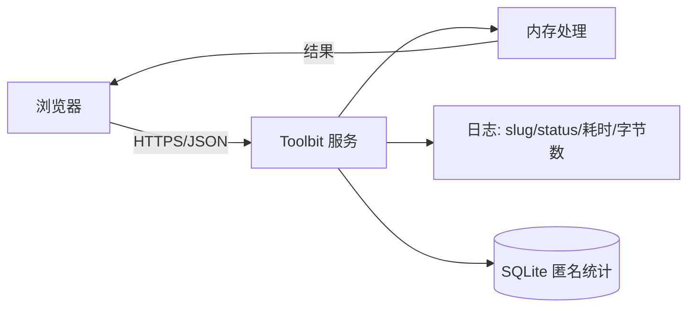

# 隐私说明

> 状态：Draft ｜ 适用版本：v0.1.0 ｜ 最后更新：2026-10-27

本文说明 Toolbit 如何处理数据、收集什么、**不**收集什么。

---

## 1. 一句话总结

> Toolbit **不**要求注册登录，**不**持久化你提交的任何密钥、证书或明文内容；
> 只记录**匿名**的工具调用计数，用于了解哪些工具有用。

---

## 2. 我们不做什么

| 不做 | 说明 |
| --- | --- |
| ❌ 不要求注册 / 登录 | 无账号、无密码、无第三方登录 |
| ❌ 不保存你提交的材料 | 密钥、证书、CSR、CRL、明文、文件内容**只**在请求处理期间存在于内存中 |
| ❌ 不写请求日志 | 日志**不含**请求体、响应体、密钥、证书正文 |
| ❌ 不做用户画像 | 无 Cookie 追踪、无指纹、无跨站跟踪 |
| ❌ 不做第三方广告 | 不接入任何广告 / 追踪 SDK |
| ❌ 不上传到云端 | 全部计算在**部署该服务的服务器**上完成 |

---

## 3. 处理你的输入

### 3.1 数据流

### 3.2 生命周期

| 阶段 | 行为 |
| --- | --- |
| 接收 | 请求体读入内存（有大小上限） |
| 处理 | 在内存中完成计算 |
| 返回 | 结果直接返回给浏览器 |
| 释放 | 请求结束后内存缓冲区被复用 / 清零 |

**关键点**

- 服务端**不**写临时文件处理上传；
- 会话结束时私钥、口令、明文缓冲区**清零**；
- 加密私钥的源缓冲区在加载后**立即**清零。

### 3.3 例外

| 工具 | 例外情况 |
| --- | --- |
| 出网类（DNS / SSL / CT / 域名验证 / 证书链获取） | 你的查询目标会收到**你的连接**（DNS 服务器、TLS 服务器等） |
| `websocket-test` | 连接由**你的浏览器**直接发起，**不**经过服务器 |
| `ct-search` | 查询会发往 CT 日志服务 |

> 这些是工具的**本质功能**，不是数据收集。服务端仍**不**记录你的输入内容。

---

## 4. 我们收集什么

### 4.1 匿名统计（可关闭）

写入本地 SQLite，用于了解工具使用情况。

| 字段 | 用途 | 是否可识别个人 |
| --- | --- | --- |
| 工具标识（slug） | 统计每个工具被用了几次 | 否 |
| 分类 | 分类统计 | 否 |
| 时间（天粒度） | 趋势 | 否 |
| HTTP 状态 / 错误码 | 成功率 | 否 |
| 耗时区间 | 性能 | 否 |
| 访客哈希 | 粗略去重 | **否**（截断并哈希，不可逆） |

**不收集**：请求体、参数内容、IP 原值、User-Agent 原文、地理位置。

**关闭方式**：设置 `TOOLBIT_STATS_ENABLED=false`。

**保留期**：原始事件 **90 天**，之后按天聚合并清理。

### 4.2 应用日志

| 记录 | 不记录 |
| --- | --- |
| 时间、级别、请求 ID | 请求体 / 响应体 |
| 工具标识 | 密钥 / 口令 |
| HTTP 状态、耗时 | 证书 / CSR / CRL 正文 |
| 字节数 | IP 原值、UA 原文 |
| 错误码 | 底层库错误文本中的输入片段 |

**关闭**：`TOOLBIT_LOG_LEVEL=error` 可显著减少记录量。

### 4.3 访客哈希

- 来源：IP 地址；
- 处理：截断（IPv4 取 `/24`）后再哈希，取前 8 字节十六进制；
- 用途：粗略估算独立访客数；
- **不能**反推原始 IP，**不能**跨工具关联同一访客的输入内容。

---

## 5. 浏览器本地存储

前端**只**在 `localStorage` 中保存偏好，**不保存**任何工具输入。

| 键 | 内容 | 说明 |
| --- | --- | --- |
| `toolbit.locale` | `zh-CN` / `en-US` | 语言偏好 |
| `toolbit.theme` | `light` / `dark` / `system` | 主题偏好 |
| `toolbit.accent` | 预设主色标识 | 主色偏好 |
| `toolbit.sidebar` | 折叠 / 展开 | 侧栏状态 |
| `toolbit.favorites` | 收藏的 slug 列表 | 收藏 |
| `toolbit.recent` | 最近使用的 slug 列表 | 最近使用 |

**明确不存**：工具输入、密钥、证书、历史结果、搜索记录。

清空浏览器数据即可全部删除。

---

## 6. 第三方

Toolbit **不**引入第三方分析 / 追踪 / 广告脚本。

| 组件 | 用途 | 说明 |
| --- | --- | --- |
| Element Plus | UI 组件库 | 纯前端，无遥测 |
| Vue / Vite / Pinia / vue-i18n | 前端框架 | 无遥测 |
| Tongsuo | 密码学 | 编译期静态链接 |
| Go 标准库 | 运行时 | 无遥测 |

**唯一的对外请求**是你主动使用出网类工具时产生的目标请求（见 §3.3）。

---

## 7. 数据保留与删除

| 数据 | 位置 | 保留期 | 删除方式 |
| --- | --- | --- | --- |
| 匿名事件 | SQLite | 90 天 | 自动清理 / 删除数据卷 |
| 日聚合 | SQLite | 365 天 | 自动清理 |
| 应用日志 | 日志系统 | 14 天 | 由运维配置 |
| 前端偏好 | 浏览器 | 直到清除 | 清除浏览器数据 |

**你提交的工具输入**：**从不保存**，无需删除。

---

## 8. 部署者须知

如果你**自行部署** Toolbit（而不是使用官方实例），以下内容由**你的部署环境**决定，官方无法替你保证：

| 项 | 建议 |
| --- | --- |
| 日志采集 | 采集器可能上报到集中式系统 —— **确认不含请求体** |
| 磁盘持久化 | 数据卷中的统计库包含匿名数据 |
| 网络出口 | 出网类工具会访问外部服务 |
| 备份 | 备份包含统计数据 |
| 反向代理 | 代理访问日志可能记录 IP 与 URL（**不**记录请求体） |

**部署者有责任**遵守其所在司法辖区的数据保护法规。

---

## 9. 儿童隐私

本服务面向 IT 从业者，**不**面向 13 岁以下儿童，且**不**主动收集任何个人信息。

---

## 10. 变更

本说明的实质性变更会在 [CHANGELOG.md](../CHANGELOG.md) 中记录。

**当前版本**：v0.1.0 ｜ **最后更新**：2026-10-27

---

## 11. 联系方式

问题反馈请通过 GitHub 仓库的 Issue 页面提交。

---

## 12. 相关文档

- [architecture.md](architecture.md) —— 架构与关键决策
- [standards/06-security.md](standards/06-security.md) —— 安全规范
- [standards/07-observability.md](standards/07-observability.md) —— 可观测性规范
- [api/admin.md](api/admin.md) —— 统计与管理端点
