# 路线图

> 状态：Draft ｜ 适用版本：v0.1.0 ~ v1.0.0 ｜ 最后更新：2026-10-28

本文记录 Toolbit 从 `v0.1.0` 到 `v1.0.0` 的版本计划。

**核心约定**

- `0.x` 是**开发预览**轨道，序号**不设上限**，允许不兼容调整；
- `1.0.0-rc.N` 是**独立的发布候选**轨道，不占用 0.x 序号；
- `1.0.0` 是**首个正式发布版本（GA）**。

---

## 1. 版本策略

### 1.1 0.x 阶段（开发预览）

| 项 | 约定 |
| --- | --- |
| 稳定性 | **不保证**向后兼容 |
| 破坏性变更 | 允许出现在 **MINOR** 位（如 `0.4.0` → `0.5.0`） |
| 披露要求 | **必须**在 [CHANGELOG](../CHANGELOG.md) 的「破坏性变更」小节逐条列出 |
| 序号上限 | **无**。按需递增 `0.10.0`、`0.11.0`、`0.12.0`… |
| 适用人群 | 项目开发者、早期体验者 |
| 部署建议 | **不应**用于生产环境 |

`0.x` 的用途不限于新增工具：补齐能力、质量硬化、范围扩展都可以占用新的 `0.x`。

### 1.2 1.0.0-rc.N（发布候选）

RC 是 `1.0.0` 的**预发布标识**，与 `0.x` 是两条独立轨道。

| 项 | 约定 |
| --- | --- |
| 命名 | `1.0.0-rc.1`、`1.0.0-rc.2`…（SemVer 预发布标识） |
| 前置条件 | `0.x` 的功能与质量版本 DoD **全部**达成 |
| **允许** | 修缺陷、补文档、不破坏契约的内部实现调整 |
| **禁止** | 新增工具、新增端点、新增依赖、变更 API 字段 / 错误码 / 警告码 |
| 轮次 | 不设上限；每轮**必须**有实际缺陷修复，**禁止**空转发版 |
| 与 0.x 的关系 | RC 期间发现设计缺陷 → **退回 `0.x`**（如 `0.11.0`）修复，再重新进入 RC |
| 出口 | 全部门禁连续通过且满足观察期 → 发布 `1.0.0` |

### 1.3 1.0.0 起（正式发布）

| 版本位 | 含义 |
| --- | --- |
| MAJOR | 破坏性变更（API 不兼容、镜像行为变化） |
| MINOR | 向后兼容的新功能（新工具、新端点） |
| PATCH | 向后兼容的缺陷修复与文档修订 |

从 `v1.0.0` 起：

- `/api/v1` **必须**只做向后兼容的新增；
- 删除字段、改变字段语义、改变错误码含义 **必须**引入 `/api/v2`；
- `backend/catalog/tools.yaml` 中已发布工具的 `slug` **禁止**改名（改名等同于删除 + 新增）。

---

## 2. 版本总览

| 版本 | 主题 | 新增工具 | 累计 | 状态 |
| --- | --- | --- | --- | --- |
| `v0.1.0` | 文档与契约 | 0 | 0 | ✅ 已完成 |
| `v0.2.0` | **后端骨架与基础设施** | 2 | 2 | 待开始 |
| `v0.2.1` | **前端骨架** | 0 | 2 | 待开始 |
| `v0.3.0` | 密码学核心 | 8 | 10 | 待开始 |
| `v0.4.0` | 密钥管理 | 6 | 16 | 待开始 |
| `v0.5.0` | PKI 解析与链验证 | 8 | 24 | 待开始 |
| `v0.6.0` | PKI 生成、吊销与容器 | 12 | 36 | 待开始 |
| `v0.7.0` | 网络探测 | 8 | 44 | 待开始 |
| `v0.8.0` | 通用工具与文档处理 | 26 | 70 | 待开始 |
| `v0.9.0` | **统计体系** | 0 | 70 | 待开始 |
| `v0.10.0`+ | 质量与硬化（可继续递增） | 0 | 70 | 待开始 |
| `v1.0.0-rc.N` | 发布候选 | 0 | 70 | 待开始 |
| `v1.0.0` | **正式发布（GA）** | 0 | 70 | 待开始 |

工具总数 **70**，与 [`backend/catalog/tools.yaml`](../backend/catalog/tools.yaml) 一致。

### 2.1 依赖顺序

```mermaid
flowchart LR
  V1["v0.1.0<br/>文档与契约"] --> V2["v0.2.0<br/>后端骨架"]
  V2 --> V21["v0.2.1<br/>前端骨架"]
  V21 --> V3["v0.3.0<br/>密码学核心"]
  V3 --> V4["v0.4.0<br/>密钥管理"]
  V4 --> V5["v0.5.0<br/>PKI 解析"]
  V5 --> V6["v0.6.0<br/>PKI 生成"]
  V6 --> V7["v0.7.0<br/>网络探测"]
  V7 --> V8["v0.8.0<br/>通用工具"]
  V8 --> V9["v0.9.0<br/>统计体系"]
  V9 --> V10["v0.10.0+<br/>质量与硬化"]
  V10 --> RC["v1.0.0-rc.N<br/>发布候选"]
  RC --> GA["v1.0.0<br/>GA"]
  RC -.->|发现设计缺陷| V10
```

每个版本**必须**在上一个版本 DoD 全部达成后才能开始，**禁止**并行开发多个 `0.x`。

### 2.2 发布节奏

- 每个 `0.x` 对应**一个** git tag + 一组镜像（`<version>` + `sha-<short>`）；
- 每个 `1.0.0-rc.N` 同样打 tag 并推镜像，供体验者验证；
- 无固定时间表，按 DoD 达成推进；
- 任一版本若 DoD 未达成，**必须**延期发布，**禁止**降级 DoD。

---

## 3. v0.1.0 —— 文档与契约（已完成）

**目标**：冻结设计，让后续所有代码有可判定的契约。

| 交付物 | 位置 |
| --- | --- |
| 项目说明 | [../README.md](../README.md) |
| 架构与关键决策 | [architecture.md](architecture.md) |
| 规范（11 篇） | [standards/](standards/) |
| 工具目录 | [../catalog/tools.yaml](../backend/catalog/tools.yaml) |
| API 契约 | [api/](api/) |
| 工具产品规格 | [tools.md](tools.md) |
| 部署 / 隐私 / 国际化 / 术语 | [deploy.md](deploy.md) [privacy.md](privacy.md) [i18n.md](i18n.md) [glossary.md](glossary.md) |

**完成标准（已达成）**

- catalog、错误码、配置项、契约四者互相一致，并由 `scripts/check-docs.mjs` 校验；
- `markdownlint-cli2` 零问题；内部链接零断链；
- 70 个工具的请求 / 响应契约全部落档。

> 本版本**不含任何可运行代码**，`backend/internal/*` 与 `frontend/` 尚未落地。

---

## 4. v0.2.0 —— 后端骨架与基础设施

**目标**：打通「分发器 → handler → 响应信封 → 统计落库」后端链路，用最简工具验证。

本版**不含任何前端产物**：`frontend/` 尚未落地，前端骨架见 §5。

### 4.1 交付物

#### 工具（2）

| 工具 | 分类 | 用途 |
| --- | --- | --- |
| `base64` | 编码 | 验证文本类链路 |
| `number-base` | 编码 | 验证数值类链路 |

#### 工程交付物

| 交付物 | 位置 | 说明 |
| --- | --- | --- |
| 进程入口与装配 | `backend/cmd/toolbit/main.go` | 配置解析、依赖装配、优雅退出 |
| 工具目录加载 | `backend/catalog/embed.go` `backend/internal/catalog/` | YAML 解析、校验、内嵌二进制 |
| 工具注册表 | `backend/internal/tools/` | slug → handler 映射，与 catalog 交叉校验 |
| HTTP 分发器 | `backend/internal/api/` | 路由、Content-Type 分支、Body 限制、超时 |
| 响应信封与中间件 | `backend/internal/httpx/` | 信封、requestId、安全响应头、访问日志、跨站校验 |
| 错误码注册表 | `backend/internal/toolerr/` | 错误码、HTTP 状态、i18n key |
| 统计落库 | `backend/internal/stats/` | 迁移、异步批量写入、保留期清理 |
| 静态资源服务 | `backend/internal/webui/` | SPA 回退、缓存头 |
| 工程门禁 | `Makefile` `.golangci.yml` `.editorconfig` | `make verify` 一条命令 |

### 4.2 技术决策

| # | 决策 | 理由 |
| --- | --- | --- |
| T1 | 后端为**独立 Go 模块**，module 路径 `github.com/blue-cloud-net/Toolbit/backend`，`go 1.25` | 与仓库地址一致；与前端 `frontend/` 形成两个独立构建单元 |
| T2 | 本版**不引入** `tongsuo-go`，`CGO_ENABLED=0` 可构建 | 两个工具不需要密码学；cgo 与 rpath 风险集中到 §6 一次性处理 |
| T3 | catalog 以 `backend/catalog/embed.go` 的 `//go:embed` 内嵌 | `//go:embed` 不能跨父目录；避免复制 YAML 破坏单一事实来源 |
| T4 | `backend/internal/catalog` 允许依赖 `gopkg.in/yaml.v3` | 需同步修改 `AGENTS.md` §2 的依赖说明 |
| T5 | `toolerr` 注册表键一律写成带引号的字符串字面量 | `scripts/check-docs.mjs` 的错误码解析正则会把常量名误判为错误码 |
| T6 | 尚未实现的工具返回 501 `NOT_IMPLEMENTED`，catalog 仍返回 70 条 | 不改动 API 形状，同时满足「首页渲染 70 个入口」 |
| T7 | 新增依赖 `gin`、`gopkg.in/yaml.v3`、`modernc.org/sqlite`、`golang.org/x/time` | 提交信息中**必须**写明 `adds: <pkg> <version>` |
| T8 | 中间件顺序为 `Recovery` → `RequestID` → `SecurityHeaders` → `AccessLog` → `BodyLimit` → `OriginCheck` → `RateLimit` | 与 [architecture.md](architecture.md) §4.1 一致 |
| T9 | `requestId` 复用入站 `X-Request-Id`（仅允许 `[A-Za-z0-9_-]{1,64}`），否则生成 16 字节随机 hex | 与 [standards/07-observability.md](standards/07-observability.md) §2 一致 |
| T10 | 限流键为直连 IP，按 `rateClass` 五档分桶，只作用于 `/api` 分组 | 首屏并发拉取 chunk，全局限流会直接 429 |
| T11 | 工具级 `timeoutMs` 在分发器内用 `context.WithTimeout` 施加，`TOOLBIT_REQUEST_TIMEOUT` 仅作兜底 | 每个工具有独立超时，配置项仅作全局上限 |
| T12 | 工具 handler 签名为 `Definition{Slug, NewRequest, Handle}`，登记显式化 | 依赖方向清晰、便于测试；禁止 `init()` 副作用注册 |

### 4.3 任务清单

#### Phase A —— 工程地基

| ID | 任务 | 改动 / 新增文件 | 验收标准 | 依赖 | 状态 |
| --- | --- | --- | --- | --- | --- |
| A1 | 工具链基线 | `backend/go.mod` `backend/go.sum` `.editorconfig` `.golangci.yml` `Makefile` | `cd backend && go build ./...` 可过；`make lint` 通过；`.golangci.yml` 的 `depguard` 限定仅 `backend/internal/cryptosvc` 可导入 `tongsuo-go` | — | ✅ |
| A2 | 错误框架 | `backend/internal/toolerr/code.go` `backend/internal/toolerr/registry.go` `backend/internal/toolerr/error.go` `backend/internal/toolerr/warning.go` `backend/internal/toolerr/error_test.go` | 注册表覆盖 [api/errors.md](api/errors.md) 的全量错误码与警告码；`scripts/check-docs.mjs` 解析出不少于 70 个错误码且全部命中文档 | A1 | ✅ |
| A3 | 配置 | `backend/internal/config/config.go` `backend/internal/config/config_test.go` | 16 个 `TOOLBIT_*` 的默认值与 [deploy.md](deploy.md) 表格逐项一致；非法值 fail-fast，日志只打变量名不打值 | A1 | ✅ |
| A4 | 目录加载 | `backend/catalog/embed.go` `backend/internal/catalog/catalog.go` `backend/internal/catalog/catalog_test.go` | 解析出 70 工具与 10 分类；校验 slug 格式、分类引用、`order` 唯一、`transport` 与 `rateClass` 枚举、`i18nKey` 与 slug 对应 | A1 | ✅ |
| A5 | 版本信息 | `backend/internal/buildinfo/buildinfo.go` | `-ldflags -X` 注入 version / commit / buildTime；未注入时回落 `0.0.0-dev` | A1 | ✅ |
| A6 | 静态资源服务 | `backend/internal/webui/static.go` `backend/internal/webui/static_test.go` | 缓存头、`no-cache`、SPA 回退、路径穿越拦截、`/api/*` 返回 JSON 404、目录缺失返回 503；用 `t.TempDir()` 构造夹具，不依赖真实前端产物 | A1 | ✅ |
| A7 | 统计落库 | `backend/internal/stats/store.go` `backend/internal/stats/writer.go` `backend/internal/stats/retention.go` `backend/internal/stats/migrations/0001_init.sql` `backend/internal/stats/store_test.go` | `tool_calls` 不含访客标识列；批量写入（2 秒 / 100 条）、队列满丢弃并计数；每日清理 `day < today-90`；`Writable(ctx)` 可判定只读目录 | A1, A3 | ✅ |

#### Phase B —— 后端主链路

| ID | 任务 | 改动 / 新增文件 | 验收标准 | 依赖 | 状态 |
| --- | --- | --- | --- | --- | --- |
| B1 | 响应信封与中间件 | `backend/internal/httpx/envelope.go` `backend/internal/httpx/requestid.go` `backend/internal/httpx/security.go` `backend/internal/httpx/accesslog.go` `backend/internal/httpx/bodylimit.go` `backend/internal/httpx/origin.go` `backend/internal/httpx/httpx_test.go` | 信封字段与 [api/README.md](api/README.md) §2 逐字对齐；错误响应带 `Cache-Control: no-store`；访问日志只含白名单字段 | A2 | ✅ |
| B2 | 工具抽象 | `backend/internal/tools/types.go` `backend/internal/tools/registry.go` `backend/internal/tools/registry_test.go` | `CrossCheck` 报出「catalog 已启用但无 handler」与「有 handler 但 catalog 无此 slug」两类不一致；slug 查询大小写敏感 | A4 | ✅ |
| B3 | 分发器 | `backend/internal/api/server.go` `backend/internal/api/dispatch.go` `backend/internal/api/catalog_handler.go` `backend/internal/api/api_test.go` | `POST /api/v1/tools/{slug}` 按 [api/README.md](api/README.md) §8 的 10 步顺序校验；`GET /api/v1/tools` 返回 70 条且 `ETag` 与 `If-None-Match` 协商生效 | B1, B2 | ✅ |
| B4 | 限流 | `backend/internal/api/ratelimit.go` `backend/internal/api/ratelimit_test.go` | 按 `rateClass` 五档分桶；429 带 `Retry-After` 与 `X-RateLimit-*`；空闲桶可回收；只作用于 `/api` 分组 | B3 | ✅ |
| B5 | 跨站校验 | `backend/internal/httpx/origin.go` `backend/internal/api/api_test.go` | `Sec-Fetch-Site: cross-site` 与 `Origin` / `Host` 不符均返回 403 `CROSS_ORIGIN_BLOCKED`；同源请求放行 | B3 | ✅ |
| B6 | `base64` 工具 | `backend/internal/tools/encoding/base64.go` `backend/internal/tools/encoding/base64_test.go` `backend/testdata/contract/base64.json` | 往返正确；`variant` 与 `padding` 生效；解码忽略空白；非法输入返回 `INVALID_BASE64` | B2 | ✅ |
| B7 | `number-base` 工具 | `backend/internal/tools/encoding/numberbase.go` `backend/internal/tools/encoding/register.go` `backend/internal/tools/encoding/numberbase_test.go` `backend/testdata/contract/number-base.json` | 任意精度（含超 64 位）；2 / 16 / 36 进制互转；进制越界返回 `INVALID_FIELD` | B2 | ✅ |
| B8 | 运维端点与装配 | `backend/internal/api/health.go` `backend/cmd/toolbit/main.go` | `/healthz` 无 I/O；`/readyz` 三项检查且超时不超过 2 秒；`/api/health` 含 `database` 字段；收到 `SIGTERM` 后停止收新连接并在超时内等完在途请求 | B1, B3, A5, A6, A7 | ✅ |

#### Phase C —— 门禁

| ID | 任务 | 改动 / 新增文件 | 验收标准 | 依赖 | 状态 |
| --- | --- | --- | --- | --- | --- |
| C1 | 后端门禁 | `Makefile` | `make verify` 串起 `go vet`、`go test -race`、golangci-lint、markdownlint 与 `scripts/check-docs.mjs`；失败时能定位到具体步骤 | A1 | ✅ |

#### Phase D —— 文档同步

| ID | 任务 | 改动 / 新增文件 | 验收标准 | 依赖 | 状态 |
| --- | --- | --- | --- | --- | --- |
| D1 | 文档同步 | `docs/roadmap.md` `CHANGELOG.md` `AGENTS.md` | 本节与实现一致且可勾选；CHANGELOG 增 `[0.2.0]`；`AGENTS.md` §2 的 catalog 依赖改为「标准库 + yaml.v3」 | 全部 | ✅ |

**关键路径**：`A1` → `A4` → `B2` → `B3` → `B4` → `C1`。

### 4.4 完成标准

1. `go build ./...`、`go vet ./...`、`go test ./... -race` 全部通过；
2. `GET /api/v1/tools` 返回 70 条目录，`ETag` 与 `If-None-Match` 协商生效；
3. 2 个工具走完整链路，响应带统一信封与 `Cache-Control: no-store`；
4. `/healthz`、`/readyz`、`/api/health`、`/api/v1/meta` 可用；收到 `SIGTERM` 后不丢进行中请求；
5. 契约测试骨架就位（`backend/testdata/contract/<slug>.json` 至少 2 份）；
6. 68 个尚未实现的工具返回 501 `NOT_IMPLEMENTED`，catalog 仍返回 70 条；
7. `make verify` 一条命令通过；
8. `scripts/check-docs.mjs` 的错误码与配置项两项从「跳过」变为「实际校验」；
9. 新增依赖在提交信息中写明 `adds: <pkg> <version>`；
10. 本版**不含**任何前端产物。

### 4.5 不在本版范围

| 项 | 计划版本 |
| --- | --- |
| 前端脚手架、首页与分类页 | §5（v0.2.1） |
| 统计的聚合、查询端点与统计页 | §12（v0.9.0） |
| 密码学能力与 Tongsuo 链接 | §6（v0.3.0） |
| CI 工作流、容器镜像与编排文件 | §13（v0.10.0+） |

### 4.6 风险

| 风险 | 影响 | 对策 |
| --- | --- | --- |
| 首个可打开网页的版本推后到 v0.2.1 | v0.2.0 只能用 curl 验收 | 契约测试覆盖完整链路；文档给出 curl 调用示例 |
| `backend/internal/webui` 早于前端产物 | 静态服务无法端到端验证 | 用 `t.TempDir()` 构造夹具，与 §5 解耦 |
| 无 CI 时门禁靠自觉 | 缺陷可能漏到下一版 | `make verify` 作为唯一闸口，写入 `AGENTS.md` 的提交前检查 |
| `check-docs.mjs` 错误码解析正则特殊 | 常量名会被误判成错误码 | 注册表键一律写成带引号的字符串字面量 |
| `tongsuo-go` 尚未接入 | 密码学能力无法验证 | 本版明确不引入，cgo 风险集中到 §6 处理 |

---

## 5. v0.2.1 —— 前端骨架

**目标**：让 v0.2.0 的后端链路在浏览器里跑起来——目录渲染、搜索、工具页与结果展示。

本版**不新增工具**，只交付前端工程底座与两个已实现工具的页面。

### 5.1 交付物

| 交付物 | 位置 | 说明 |
| --- | --- | --- |
| 前端工程 | `frontend/` | Vite + Vue 3 + TypeScript + Element Plus + Pinia + vue-i18n + UnoCSS |
| 目录与发现 | `frontend/src/stores/catalog.ts` `frontend/src/views/` `frontend/src/components/discovery/` | 首页、分类页、搜索、404 |
| 快捷入口与偏好 | `frontend/src/stores/prefs.ts` `frontend/src/views/RecentView.vue` `frontend/src/views/FavoritesView.vue` | 全部工具、最近使用、我的收藏；侧栏折叠；主题与语言 |
| 工具页骨架 | `frontend/src/components/tool/` `frontend/src/composables/useToolRun.ts` | 输入 → 参数 → 运行 → 结果 的统一骨架 |
| 两个工具页 | `frontend/src/tools/encoding/` | `base64`、`number-base` |
| 双语词条 | `frontend/src/locales/` | `zh-CN` 与 `en-US` |
| 前端门禁 | `Makefile` `scripts/check-budget.mjs` | 体积预算与 lint、type-check、test、build |

### 5.2 技术决策

| # | 决策 | 理由 |
| --- | --- | --- |
| F-T1 | 词条按 [i18n.md](i18n.md) §2 的目录结构落地，`errors.json` 顶层直接是错误码 key | 与既有约定一致，不再套一层 `{"errors":{}}` |
| F-T2 | 主题（`system` / `light` / `dark`）与语言切换在本版落地；8 组主色预设延后到 §11 | 控制本版体量；主色还涉及对比度校验 |
| F-T3 | 工具组件静态登记在 `frontend/src/tools/index.ts`，slug 到组件是编译期映射 | 目录数据只提供展示元信息，避免运行时拼装组件 |
| F-T4 | 工具输入**不写**任何浏览器存储；仅偏好（语言、主题、侧栏）写 `localStorage` | 敏感输入离开页面即清空 |
| F-T5 | API 通信只经 `frontend/src/api/client.ts`，统一拆信封与错误码本地化 | 组件内禁止直接 `fetch` |
| F-T6 | 体积预算：初始 JS < 250 KB（gzip）、单工具 chunk < 40 KB（gzip） | 与 §13 的性能预算门禁保持同一口径 |
| F-T7 | 收藏与最近使用只存 **slug 列表**，不存任何工具输入；最近使用上限 12 条 | 偏好可持久化，输入不行 |

### 5.3 任务清单

#### Phase F —— 前端工程

| ID | 任务 | 改动 / 新增文件 | 验收标准 | 依赖 | 状态 |
| --- | --- | --- | --- | --- | --- |
| F1 | 工程脚手架 | `frontend/package.json` `frontend/pnpm-lock.yaml` `frontend/index.html` `frontend/vite.config.ts` `frontend/tsconfig.json` `frontend/tsconfig.node.json` `frontend/uno.config.ts` `frontend/eslint.config.js` `frontend/vitest.config.ts` `frontend/src/main.ts` `frontend/src/App.vue` | `pnpm lint`、`pnpm type-check`、`pnpm test`、`pnpm build` 全绿；Element Plus 按需自动导入；按分类拆分 chunk | A1 | ✅ |
| F2 | 设计令牌与布局 | `frontend/src/styles/tokens.css` `frontend/src/styles/base.css` `frontend/src/styles/element-overrides.css` `frontend/src/layouts/DefaultLayout.vue` `frontend/src/components/layout/AppHeader.vue` `frontend/src/components/layout/AppSidebar.vue` `frontend/src/components/layout/AppFooter.vue` `frontend/src/stores/prefs.ts` | 颜色全部来自 `--tb-*` 变量；主题与语言切换即时生效并持久化；`<html lang>` 同步；`header` / `nav` / `main` / `footer` 地标齐备 | F1 | ✅ |
| F3 | API 客户端与类型 | `frontend/src/api/client.ts` `frontend/src/api/client.test.ts` `frontend/src/types/api.ts` `frontend/src/types/tools.ts` | 统一拆信封；`error.code` 映射到 `errors.<CODE>` 并插值 `params`；支持取消与超时归一化 | F1 | ✅ |
| F4 | 目录 store 与页面 | `frontend/src/stores/catalog.ts` `frontend/src/views/HomeView.vue` `frontend/src/views/CategoryView.vue` `frontend/src/views/NotFoundView.vue` `frontend/src/components/discovery/ToolCard.vue` `frontend/src/components/discovery/CategoryCard.vue` | 首页渲染 70 个入口与 10 个分类；搜索按中英文名过滤；未实现工具的卡片禁用并标注「即将上线」 | F3 | ✅ |
| F5 | 工具页骨架 | `frontend/src/components/tool/ToolPageLayout.vue` `frontend/src/components/tool/ToolPanel.vue` `frontend/src/components/tool/RunBar.vue` `frontend/src/components/tool/ResultPanel.vue` `frontend/src/components/tool/ErrorAlert.vue` `frontend/src/components/tool/CopyButton.vue` `frontend/src/components/tool/EncodingSelect.vue` `frontend/src/composables/useToolRun.ts` | 四态齐备（idle / loading / success / error）；错误内联展示并带错误码 chip 与重试；`aria-live` 播报；`Ctrl` / `Cmd` + `Enter` 运行；`wide` 工具在 1280 像素以上双栏，移动端运行按钮吸底 | F3 | ✅ |
| F6 | 两个工具页与词条 | `frontend/src/tools/index.ts` `frontend/src/tools/encoding/base64/index.ts` `frontend/src/tools/encoding/base64/Tool.vue` `frontend/src/tools/encoding/base64/example.ts` `frontend/src/tools/encoding/number-base/index.ts` `frontend/src/tools/encoding/number-base/Tool.vue` `frontend/src/tools/encoding/number-base/example.ts` `frontend/src/locales/zh-CN/common.json` `frontend/src/locales/zh-CN/home.json` `frontend/src/locales/zh-CN/tool.json` `frontend/src/locales/zh-CN/errors.json` `frontend/src/locales/en-US/common.json` `frontend/src/locales/en-US/home.json` `frontend/src/locales/en-US/tool.json` `frontend/src/locales/en-US/errors.json` `frontend/src/locales/zh-CN/tools/base64.json` `frontend/src/locales/zh-CN/tools/number-base.json` `frontend/src/locales/en-US/tools/base64.json` `frontend/src/locales/en-US/tools/number-base.json` | 「填入示例 → 运行 → 复制」全链路可用；工具输入不写任何浏览器存储；`zh-CN` 与 `en-US` 的词条 key 集合完全一致 | F4, F5 | ✅ |
| F7 | 前端门禁与体积预算 | `Makefile` `scripts/check-budget.mjs` | `make verify` 覆盖前端四命令；初始 JS 小于 250 KB（gzip）、单工具 chunk 小于 40 KB（gzip），超限时退出码非 0 | F1 | ✅ |
| F8 | 文档同步 | `docs/roadmap.md` `CHANGELOG.md` | 本节与实现一致且可勾选；CHANGELOG 增 `[0.2.1]` | F1 – F7 | ✅ |

### 5.4 完成标准

1. 首页渲染 70 个入口与 10 个分类，分类与搜索可用；
2. 两个工具页「填入示例 → 运行 → 复制」全链路可用；
3. 语言与主题切换后刷新仍保持，`<html lang>` 与实际语言一致；
4. 初始 JS 小于 250 KB（gzip）、单工具 chunk 小于 40 KB（gzip）；
5. 工具输入不写入 `localStorage`、`sessionStorage` 或 IndexedDB；
6. `pnpm lint`、`pnpm type-check`、`pnpm test`、`pnpm build` 与 `make verify` 全部通过；
7. `zh-CN` 与 `en-US` 的词条 key 集合一致，工具词条覆盖 `name`、`description`、`category`、`actions`、`fields`、`options`、`results`、`examples`、`hints`、`faq` 十个字段。

### 5.5 不在本版范围

| 项 | 计划版本 |
| --- | --- |
| 8 组主色预设 | §11（v0.8.0） |
| 统计页与图表库 | §12（v0.9.0） |
| 端到端测试与可访问性扫描 | §13（v0.10.0+） |

### 5.6 风险

| 风险 | 影响 | 对策 |
| --- | --- | --- |
| 体积预算在本版才建立 | v0.2.0 阶段没有前端产物可测 | 预算随首个前端版本一并落地 |
| 70 个入口中 68 个未实现 | 首页观感偏「空」 | 卡片禁用并标注「即将上线」，不隐藏入口 |
| 词条字段集若后续变更 | 双语文件需同步返工 | 字段集在 [i18n.md](i18n.md) 固定，改动须同步三处 |

---

## 6. v0.3.0 —— 密码学核心

**目标**：国密能力就继，建立 `cryptosvc` 与句柄生命周期规范。

### 交付物（8）

| 工具 | 备注 |
| --- | --- |
| `hash-calc` | SM3 / SHA 系列 / MD5 |
| `hmac-gen` | 含 HMAC-SM3 |
| `password-gen` | CSPRNG |
| `symmetric-crypt` | SM4 / AES，含 GCM |
| `asymmetric-crypt` | SM2（默认 `C1C3C2` + `04` 前缀）/ RSA / ECIES |
| `signature` | SM2 / RSA / ECDSA / Ed25519 / Ed448 |
| `ecdh` | P-256/384/521、X25519/X448 |
| `sm4-file-crypt` | TBFC 容器，分块流式 |

**完成标准**

- SM3 / SM4 国标标准向量全部通过；
- SM2 签名 / 验签 / 加解密 / `C1C2C3`↔`C1C3C2` 互转往返正确；
- `Session.Close()` 幂等；`priv.Public()` 不被单独关闭；句柄零泄漏；
- 重操作信号量（≤2）与超时（504）路径有测试；
- 8 个工具各有正例 + 反例契约测试。

---

## 7. v0.4.0 —— 密钥管理

**目标**：密钥全生命周期（生成 → 转换 → 解析 → 运算 → 配对）可用。

### 交付物（6）

| 工具 | 备注 |
| --- | --- |
| `keygen` | RSA / SM2 / EC / Ed25519 / Ed448 / X25519 / X448 |
| `key-convert` | PKCS#1 / PKCS#8 / SPKI / DER / PEM 互转 |
| `key-parse` | 算法、长度、曲线、参数、指纹 |
| `key-ops` | 加密、解密、提取公钥、改口令 |
| `key-match` | 私钥 ↔ 公钥 / 证书配对检测 |
| `jwk-xml-convert` | JWK / PEM / XML 互转 |

**完成标准**

- 7 种算法：生成 → PEM 往返 → 口令加密 → 解析 全链路通过；
- RSA 1024–4096 边界、口令错误路径（`PASSPHRASE_INCORRECT`）有测试；
- JWK / XML / PEM 三向互转结果一致；
- 私钥材料不落日志、不落磁盘（`grep` 校验日志输出）。

---

## 8. v0.5.0 —— PKI 解析与链验证

**目标**：能读懂证书，并能判定一条链是否可信。

### 交付物（8）

| 工具 | 备注 |
| --- | --- |
| `cert-parse` | 证书详情、有效期状态、指纹 |
| `csr-parse` | 主体、SAN、公钥、扩展 |
| `pem-der` | PEM ↔ DER 互转 |
| `asn1-view` | DER 结构树 |
| `cert-chain-parse` | 链排序与缺失检测 |
| `cert-chain-verify` | 链可信性 + 域名匹配 |
| `cert-chain-repair` | 补全缺失中间证书（纯本地） |
| `crl-parse` | 吊销列表解析 |

**完成标准**

- 自签 CA → 叶证书 场景下，链排序 / 验证 / 域名匹配全部正确；
- 有效期边界（`expired` / `not_yet_valid`）与自签名判定有测试；
- 用户输入构造 DN **一律**走 `x509.Name.TryAdd`，非法字段返回 `INVALID_FIELD` 且**不 panic**；
- 每请求新建 `x509.Store`（`SetTime` 不污染后续验证）；
- 链上限 64 张、CRL 上限 10000 条，超限返回 `TOO_MANY_ITEMS`。

---

## 9. v0.6.0 —— PKI 生成、吊销与容器

**目标**：能签发证书，处理吊销，并读写 PKCS#12 / PKCS#7 容器。

### 交付物（12）

| 工具 | 备注 |
| --- | --- |
| `csr-gen` | PKCS#10 签名请求 |
| `cert-gen` | 自签 / CA 签发 |
| `crl-gen` | CRL 签发 |
| `revocation-check` | CRL 吊销判定 |
| `ocsp-request` | OCSP 请求生成 |
| `ocsp-response` | OCSP 响应解析 |
| `pfx-pack` | PKCS#12 打包 |
| `pfx-parse` | PKCS#12 解析 |
| `pfx-change-password` | PKCS#12 改密 |
| `p7b-pack` | PKCS#7 打包 |
| `p7b-extract` | PKCS#7 提取 |
| `caa-gen` | CAA 记录生成 |

**完成标准**

- 自签 CA → CSR → 叶证书 → CRL → 吊销检查 全链路通过；
- PKCS#12 打包 / 解析 / 改密往返一致；PKCS#7 打包 / 提取往返一致；
- `signMode: ca` 时**必须**校验签发者私钥与证书配对，不匹配返回 `KEY_MISMATCH`；
- 吊销原因码 `7`（保留值）被拒绝；
- `RevocationCheck` 前**必须**先 `CRL.Verify`，该顺序有测试覆盖。

---

## 10. v0.7.0 —— 网络探测

**目标**：出网能力就继，SSRF 防护全覆盖。

### 交付物（8）

| 工具 | 备注 |
| --- | --- |
| `cidr-calc` | 纯计算，不出网 |
| `ssl-check` | WebSocket 流式握手检测 |
| `dns-lookup` | UDP / TCP / DoT / DoH |
| `dns-tester` | whois / DNSSEC / PTR |
| `websocket-test` | 纯前端，**无后端端点** |
| `cert-chain-fetch` | 从目标主机抓链 |
| `ct-search` | 证书透明度查询 |
| `domain-verify` | 域名所有权验证 |

**完成标准**

- 全部出网工具经 `backend/internal/netguard`：私网 / 回环 / 链路本地 / `0.0.0.0/8` / IPv4-mapped IPv6 全部拦截，返回 `SSRF_BLOCKED`；
- 重定向逐跳校验（≤3 跳）；连接使用**已校验的 IP**（防 DNS rebinding）；
- `ssl-check` 四条路径（正常 / 非法输入 / 超时 / 客户端取消）有测试；
- `TOOLBIT_NETWORK_ENABLED=false` 时全部返回 `NETWORK_DISABLED`；
- `websocket-test` 确认无后端端点，catalog 为 `transport: client`。

---

## 11. v0.8.0 —— 通用工具与文档处理

**目标**：工具补齐至 70，全部功能面完成。

### 交付物（26）

| 分类 | 工具 |
| --- | --- |
| 编码（4） | `url-codec` `jwt-codec` `encoding-convert` `gzip-deflate` |
| 格式化（8） | `json-format` `js-format` `sql-format` `html-format` `xml-format` `toml-format` `yaml-format` `format-convert` |
| 文本（2） | `regex-tester` `text-convert` |
| 数据（6） | `timestamp` `uuid-gen` `date-calc` `country-code` `cn-regions` `qr-code` |
| 系统（3） | `curl-generator` `crontab-generator` `chmod-calc` |
| 文档（3） | `pdf-sign-verify` `markdown-preview` `eml-parser` |

> `base64` 与 `number-base` 已在 v0.2.0 交付，本版不重复计入。

**完成标准**

- **70 / 70** 工具可用，契约测试覆盖率 100%；
- 每个工具 `zh-CN` / `en-US` 词条齐备，key 集合与占位符一致；
- `pdf-sign-verify` 底层库缺失时返回 `NOT_IMPLEMENTED`（501），降级路径有测试；
- `markdown-preview` 的 XSS 净化测试通过（`script` / 事件属性 / `javascript:` 全部被移除）；
- `gzip-deflate` 解压炸弹、`yaml-format` 别名展开攻击均有上限防护测试。

---

## 12. v0.9.0 —— 统计体系

**目标**：让匿名统计从「只落库」升级为「可读、可展示」，并给出公开的统计页与口径说明。

本版**不新增工具**，只交付统计的聚合、查询端点与展示页面。落库管道已在 §4 的 A7 就绪，本版在其之上补齐访客维度与聚合。

### 12.1 交付物

| 交付物 | 位置 | 说明 |
| --- | --- | --- |
| 访客标识与日聚合 | `backend/internal/stats/migrations/0002_visitor_and_daily.sql` `backend/internal/stats/aggregate.go` | 访客去重、日聚合表、日盐轮换 |
| 实时活跃窗口 | `backend/internal/stats/live.go` | 2 分钟滑动窗口内的独立访客数 |
| 统计端点 | `backend/internal/api/stats_summary.go` `backend/internal/api/stats_trend.go` `backend/internal/api/stats_popular.go` `backend/internal/api/stats_overview.go` | 公开摘要与趋势、受保护的详情 |
| 统计页 | `frontend/src/views/StatsView.vue` `frontend/src/components/stats/` | 数字卡、趋势图、热门工具、口径说明 |
| 图表库 | `frontend/package.json` | `chart.js` v4，仅在统计页 chunk 引入 |
| 文档同步 | `docs/privacy.md` `docs/architecture.md` `docs/api/admin.md` `docs/api/README.md` `AGENTS.md` | 访客标识口径与端点契约 |

### 12.2 统计口径

| 指标 | 定义 | 数据来源 |
| --- | --- | --- |
| 实时在线 | 最近 2 分钟内有工具调用的独立访客数 | 内存滑动窗口，不落库 |
| 今日浏览 / 累计浏览 | 工具调用总次数 | 明细表与日聚合表 |
| 今日访客 / 累计访客 | 去重访客数；键优先 `visitor_id`，缺失时回退 `ip_day_hash` | 日访客去重表 |
| 工具数量 / 分类数 | catalog 中已启用的工具数与分类数 | catalog，不落库 |
| 趋势 | 近 24 小时（按小时）与近 30 天（按天）的调用数与访客数 | 明细表与日聚合表 |
| 热门工具 | Top N 的调用次数与独立访客数 | 日聚合表 |
| 保留期 | 明细 90 天，日聚合永久 | 清理任务已在 §4 的 A7 落地 |
| 爬虫 | 命中 UA 特征的请求不计入任何指标 | 内存过滤，不落库 |

### 12.3 技术决策

| # | 决策 | 理由 |
| --- | --- | --- |
| S-T1 | 访客标识为双层：`visitor_id` 取前端 `localStorage` 随机 UUID 的原值；`ip_day_hash` 取 `HMAC(日盐 ‖ IP ‖ 日期)` 的前 16 字节，盐按日轮换 | 前者跨日稳定、可算累计访客；后者不可逆且跨日不可关联，作为缺失时的回退 |
| S-T2 | 「累计浏览」按工具调用次数计，不新增页面浏览上报端点 | 避免客户端上报带来的刷量面与额外隐私字段 |
| S-T3 | 「实时在线」为 2 分钟滑动窗口内的独立访客 | 无心跳上报时窗口是唯一可解释的近似；页面须写明「静止阅读不计入」 |
| S-T4 | 图表库固定 `chart.js` v4，按需注册 line 与 bar，只做简单折线与柱状，仅在统计页 chunk 引入 | 需同步放开 [standards/01-frontend.md](standards/01-frontend.md) §11 的禁令，并新增「统计页 chunk < 120 KB（gzip）」预算 |
| S-T5 | 日聚合表永久保留，累计值读聚合表 | 明细清理到 90 天后，累计数不会随之减少 |
| S-T6 | 爬虫只在内存按 UA 特征过滤，UA 原文不入库、不入日志 | 既能排除爬虫，又不扩大隐私面 |

### 12.4 任务清单

#### Phase S —— 存储与聚合

| ID | 任务 | 改动 / 新增文件 | 验收标准 | 依赖 |
| --- | --- | --- | --- | --- |
| S1 | 访客与聚合迁移 | `backend/internal/stats/migrations/0002_visitor_and_daily.sql` `backend/internal/stats/store_test.go` | 新增 `tool_calls.visitor_id` 与 `tool_calls.ip_day_hash`（均可空）、`stats_daily`、`stats_daily_visitors`；从 `0001` 增量升级幂等；历史空值不参与访客去重 | A7 |
| S2 | 写入链路增强 | `backend/internal/stats/writer.go` `backend/internal/stats/filter.go` `backend/internal/stats/writer_test.go` | 从 `X-Visitor-Id` 取原值落库；`ip_day_hash` 按日盐生成且盐跨日轮换（有测试）；爬虫请求在内存过滤后不写库 | S1 |
| S3 | 实时活跃窗口 | `backend/internal/stats/live.go` `backend/internal/stats/live_test.go` | 2 分钟窗口内的去重访客数正确；边界用注入时钟验证；过期条目清理后内存占用回落 | S1 |
| S4 | 日聚合 | `backend/internal/stats/aggregate.go` `backend/internal/stats/aggregate_test.go` | 幂等写入 `stats_daily`；`viewers` 由去重表派生；跨日边界与重复事件不重复计数 | S1, S2 |

#### Phase T —— 统计端点

| ID | 任务 | 改动 / 新增文件 | 验收标准 | 依赖 |
| --- | --- | --- | --- | --- |
| T1 | 公开统计端点 | `backend/internal/api/stats_summary.go` `backend/internal/api/stats_trend.go` `backend/internal/api/stats_popular.go` `backend/internal/api/stats_test.go` | `summary` 返回实时、今日与累计的浏览与访客、工具与分类数；`trend?range=24h\|30d` 分桶正确；`popular` 增加访客数字段；参数越界回落默认值；统计关闭时返回零值而非错误 | S3, S4 |
| T2 | 受保护详情端点 | `backend/internal/api/stats_overview.go` `backend/internal/api/stats_overview_test.go` | `X-Stats-Token` 以常数时间比较；错误或缺失返回 401 `STATS_UNAUTHORIZED`；未配置 Token 时返回 404；`Cache-Control: no-store` | S4 |

#### Phase U —— 页面与文档

| ID | 任务 | 改动 / 新增文件 | 验收标准 | 依赖 |
| --- | --- | --- | --- | --- |
| U1 | 放开图表库 | `docs/standards/01-frontend.md` | §1 技术栈列出 `chart.js` v4；§11 由「禁止图表库」改为「唯一允许 `chart.js`，仅在统计页 chunk 引入，只做简单折线与柱状」；新增「统计页 chunk < 120 KB（gzip）」预算行 | — |
| U2 | 统计页 | `frontend/src/views/StatsView.vue` `frontend/src/components/stats/StatCard.vue` `frontend/src/components/stats/TrendChart.vue` `frontend/src/components/stats/PopularTable.vue` `frontend/src/components/stats/CaveatList.vue` `frontend/src/composables/useStatsPolling.ts` `frontend/src/composables/useVisitorId.ts` `frontend/src/api/stats.ts` `frontend/src/types/stats.ts` `frontend/src/locales/zh-CN/stats.json` `frontend/src/locales/en-US/stats.json` | 四类数字卡与工具、分类数量齐备；24 小时与 30 天双趋势由 `chart.js` 渲染；Top 20 展示次数与人数；口径说明不少于 5 条；15 秒轮询且页面隐藏时暂停；`prefers-reduced-motion` 下不动画；移动端不横向滚动 | T1, U1, F4 |
| U3 | 隐私与契约文档 | `docs/privacy.md` `docs/architecture.md` `docs/api/admin.md` `docs/api/README.md` `AGENTS.md` | 三处访客标识定义统一；`privacy.md` 如实披露本地随机标识的用途与清除方式并登记存储键；`admin.md` 覆盖 4 个统计端点与缓存头 | S1, T1, T2 |

**关键路径**：`S1` → `S2` → `S4` → `T1` → `U2`。

### 12.5 完成标准

1. 统计页四类数字与双趋势可用，数值与直接查询数据库一致；
2. `TOOLBIT_STATS_ENABLED=false` 时页面显示零值、不报错、不写库；
3. `visitor_id` 缺失时访客数自动回退 `ip_day_hash`；日盐按日轮换有测试覆盖；
4. 爬虫请求不计入任何指标，日志中无 UA 原文；
5. `overview` 未配置 Token 时返回 404，Token 错误时返回 401；
6. 统计页 chunk 小于 120 KB（gzip），初始 JS 仍小于 250 KB（gzip）；
7. `privacy.md` 与实现一致，`scripts/check-docs.mjs` 与 markdownlint 零问题。

### 12.6 风险

| 风险 | 影响 | 对策 |
| --- | --- | --- |
| 访客标识原值入库 | 可在跨日维度关联同一访客，与「无用户画像」的表述冲突 | 同步改写 `privacy.md` §2 的措辞，并登记存储键与清除方式 |
| 「累计浏览」实际是调用次数 | 与常见的页面 PV 含义不同 | 统计页与文档用同一措辞，不混用「浏览量」字样 |
| 实时在线是近似值 | 静止阅读页面的访客不计入 | 口径说明中明示窗口长度与近似性质 |
| `chart.js` 体积 | 统计页 chunk 可能超预算 | 仅注册 line 与 bar 并懒加载；超预算时在本版内压缩，不引入第二个库 |
| 采集自 v0.2.0 起而聚合自 v0.9.0 起 | 早期数据只存在于明细 | 聚合任务上线时回填既有明细，日聚合表可增量补齐 |

---

## 13. v0.10.0+ —— 质量与硬化（可继续递增）

**目标**：把 GA 所需的全部质量门禁**建成并达成**。本版起 `0.x` 轨道转为质量向，序号可继续递增（`0.11.0`、`0.12.0`…）。

### 为什么不在 RC 里做

门禁建设是「工作」（写 E2E、做性能优化、配多架构镜像），会让版本行为发生变化。
放在 `0.x` 里做完，RC 才能只做「验证不再有缺陷」这一件事。

### 门禁清单

| 门禁 | 判定标准 |
| --- | --- |
| 文档一致性 | `scripts/check-docs.mjs` 零问题（catalog / 错误码 / 配置项 / i18n 四者一致） |
| Markdown | `markdownlint-cli2` 零问题 |
| 内部链接 | `lychee` 零断链 |
| E2E | Playwright 覆盖 70 个工具路由 + 关键路径，全绿 |
| 可访问性 | `axe` 扫描无 serious / critical；预设主色对比度 ≥ 4.5:1 |
| 性能预算 | 初始 JS < 250 KB（gzip）；单工具 chunk < 40 KB；统计页 chunk < 120 KB |
| 依赖安全 | `govulncheck`、`pnpm audit`、Trivy 无 high 及以上 |
| 镜像 | 多架构、非 root（UID 10001）、基础镜像 digest 固定、`healthcheck` 可用 |
| 运维演练 | 升级 / 回滚 / 备份恢复 三项演练通过 |
| 可复现部署 | 第三方按 [deploy.md](deploy.md) 在 30 分钟内完成部署并通过 `/readyz` |

**完成标准**

- 上表 **10 项门禁全部达成**，且连续两个 `0.x` 版本保持通过；
- 若本版范围扩展（追加工具或能力），**必须**同步更新 [tools.md](tools.md)、[api/](api/) 与 [`backend/catalog/tools.yaml`](../backend/catalog/tools.yaml)，并递增为 `0.11.0`。

---

## 14. v1.0.0-rc.N —— 发布候选

**目标**：在不引入任何新东西的前提下，证明 `1.0.0` 可以发布。

### 硬性约束

| 约束 | 说明 |
| --- | --- |
| **禁止**新增工具 | 工具集合已冻结 |
| **禁止**新增端点 / 字段 | `/api/v1` 契约已冻结 |
| **禁止**新增依赖 | 除非修复安全漏洞，且需在 CHANGELOG 说明 |
| **禁止**变更错误码 / 警告码 | 只允许修缺陷 |
| **禁止**降级门禁 | 任一门禁失败即阻塞发布 |

### 每一轮 RC 必须

- 有**实际缺陷修复**（**禁止**空转发版）；
- 保持 §13 的 **10 项门禁**全部通过；
- 在 [CHANGELOG](../CHANGELOG.md) 记录本轮修复项与已知问题。

### 回退路径

RC 期间若发现**设计层面**缺陷（不是实现 bug），**必须**退回 `0.x`（如 `0.11.0`）修复，
修复完成后重新进入 `1.0.0-rc.1`，**禁止**在 RC 里绕过约束打补丁。

### 退出条件

- 全部门禁保持通过；
- 连续 **14 天**无 P0 / P1 缺陷；
- 无已知的契约级问题。

---

## 15. v1.0.0 —— 正式发布（GA）

**目标**：首个可用于生产的正式版本。

### 完成标准

| 项 | 判定 |
| --- | --- |
| RC 出口 | §14 退出条件全部满足 |
| 全部门禁 | §13 的 10 项门禁**全部**保持通过 |
| 发布公证 | git tag `v1.0.0`、[CHANGELOG](../CHANGELOG.md) 条目、许可证、第三方声明、隐私说明齐备 |
| 镜像 | 以**不可变**标签发布（`1.0.0` + `sha-<short>`），推送 GHCR 双架构 |
| 部署可复现 | 第三方按 [deploy.md](deploy.md) 在 30 分钟内完成部署并通过 `/readyz` |
| 兼容承诺生效 | §1.3 的 SemVer 承诺从本版本起生效 |

### 发布后

- `1.0.x`：只修缺陷，不改 API；
- `1.x.0`：新增工具或向后兼容的新端点；
- `2.0.0`：仅在确实需要破坏 `/api/v1` 时引入。

---

## 16. 1.x 展望

| 项 | 说明 |
| --- | --- |
| JSON Schema | `GET /api/v1/schema/{slug}` 自动生成 |
| OpenAPI | 由反射生成 OpenAPI 3.1 文档 |
| 收藏同步 | 可选的加密导出 / 导入 |
| 更多语言 | 繁体中文、日语 |
| 批量处理 | 多文件 / 多条输入并行 |
| SM9 | 基于标识的密码算法 |
| 链自动下载 | 证书链自动获取（需显式授权） |

---

## 17. 明确不做

| 项 | 原因 |
| --- | --- |
| 用户账号体系 | 违背「无账号、隐私优先」的设计 |
| 服务端存储用户数据 | 会引入数据泄露风险 |
| 内置 TLS | 交由反向代理，减少实现复杂度与配置面 |
| 自研密码算法 | 安全风险；一律使用 Tongsuo |
| 移动端原生 App | Web 覆盖足够，且维护成本高 |
| 插件系统 | v1 工具集合固定，避免不可信扩展 |

---

## 18. 风险与对策

| 风险 | 影响 | 对策 |
| --- | --- | --- |
| `tongsuo-go` 版本漂移 | API 不兼容 | CI 用 `go doc` 快照比对；锁 `go.sum` |
| PDF 签名库不可用 | `pdf-sign-verify` 缺失 | 降级返回 501；契约在 v0.8.0 前冻结 |
| 容器内 cgo 兼容性 | 镜像无法启动 | 固定基础镜像 digest；`healthcheck` 兜底 |
| 70 个工具范围过大 | 交付延期 | 分 7 个功能版本；每个 DoD 独立可判定 |
| 出网工具被滥用 | 资源消耗 / 被用于攻击 | SSRF 校验 + 限流 + 出网总开关 |
| 单进程吞吐不足 | 高并发下体验差 | 重操作信号量；后续可横向扩展（统计库为共享瓶颈） |
| 0.x 破坏性变更影响体验者 | 升级成本 | CHANGELOG 强制披露；提供迁移说明 |
| 范围扩展到 70 个工具之外 | 0.x 序号膨胀 | 按 `0.10.0+` 规则递增，同步 catalog 与文档 |
| 版本序列中出现 `v0.2.1` | 版本号不再是纯小数递增，易被误解为补丁版 | 语义上是 `v0.3.0` 的前置版本，本页与 CHANGELOG 均显式说明 |
| RC 期间发现设计缺陷 | GA 延期 | 退回 `0.x` 修复后重新进 RC，**禁止**在 RC 内绕过 |

---

## 19. 相关文档

- [architecture.md](architecture.md) —— 架构与关键决策
- [standards/09-docs.md](standards/09-docs.md) —— 文档规范与同步矩阵
- [standards/10-git.md](standards/10-git.md) —— 版本号与分支约定
- [../AGENTS.md](../AGENTS.md) —— 协作约定
- [../CHANGELOG.md](../CHANGELOG.md) —— 变更记录
