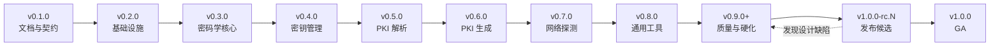

# 路线图

> 状态：Draft ｜ 适用版本：v0.1.0 ~ v1.0.0 ｜ 最后更新：2026-10-27

本文记录 Toolbit 从 `v0.1.0` 到 `v1.0.0` 的版本计划。

**核心约定**

- `0.x` 是**开发预览**轨道，序号**不设上限**，允许不兼容调整；
- `1.0.0-rc.N` 是**独立的发布候选**轨道，不占用 0.x 序号；
- `1.0.0` 是**首个正式发布版本（GA）**。

---

## 1. 版本策略

### 1.1 0.x 阶段（开发预览）

| 项 | 约定 |
| --- | --- |
| 稳定性 | **不保证**向后兼容 |
| 破坏性变更 | 允许出现在 **MINOR** 位（如 `0.4.0` → `0.5.0`） |
| 披露要求 | **必须**在 [CHANGELOG](../CHANGELOG.md) 的「破坏性变更」小节逐条列出 |
| 序号上限 | **无**。按需递增 `0.9.0`、`0.10.0`、`0.11.0`… |
| 适用人群 | 项目开发者、早期体验者 |
| 部署建议 | **不应**用于生产环境 |

`0.x` 的用途不限于新增工具：补齐能力、质量硬化、范围扩展都可以占用新的 `0.x`。

### 1.2 1.0.0-rc.N（发布候选）

RC 是 `1.0.0` 的**预发布标识**，与 `0.x` 是两条独立轨道。

| 项 | 约定 |
| --- | --- |
| 命名 | `1.0.0-rc.1`、`1.0.0-rc.2`…（SemVer 预发布标识） |
| 前置条件 | `0.x` 的功能与质量版本 DoD **全部**达成 |
| **允许** | 修缺陷、补文档、不破坏契约的内部实现调整 |
| **禁止** | 新增工具、新增端点、新增依赖、变更 API 字段 / 错误码 / 警告码 |
| 轮次 | 不设上限；每轮**必须**有实际缺陷修复，**禁止**空转发版 |
| 与 0.x 的关系 | RC 期间发现设计缺陷 → **退回 `0.x`**（如 `0.10.0`）修复，再重新进入 RC |
| 出口 | 全部门禁连续通过且满足观察期 → 发布 `1.0.0` |

### 1.3 1.0.0 起（正式发布）

| 版本位 | 含义 |
| --- | --- |
| MAJOR | 破坏性变更（API 不兼容、镜像行为变化） |
| MINOR | 向后兼容的新功能（新工具、新端点） |
| PATCH | 向后兼容的缺陷修复与文档修订 |

从 `v1.0.0` 起：

- `/api/v1` **必须**只做向后兼容的新增；
- 删除字段、改变字段语义、改变错误码含义 **必须**引入 `/api/v2`；
- `catalog/tools.yaml` 中已发布工具的 `slug` **禁止**改名（改名等同于删除 + 新增）。

---

## 2. 版本总览

| 版本 | 主题 | 新增工具 | 累计 | 状态 |
| --- | --- | --- | --- | --- |
| `v0.1.0` | 文档与契约 | 0 | 0 | ✅ 已完成 |
| `v0.2.0` | 基础设施与骨架 | 2 | 2 | 待开始 |
| `v0.3.0` | 密码学核心 | 8 | 10 | 待开始 |
| `v0.4.0` | 密钥管理 | 6 | 16 | 待开始 |
| `v0.5.0` | PKI 解析与链验证 | 8 | 24 | 待开始 |
| `v0.6.0` | PKI 生成、吊销与容器 | 12 | 36 | 待开始 |
| `v0.7.0` | 网络探测 | 8 | 44 | 待开始 |
| `v0.8.0` | 通用工具与文档处理 | 26 | 70 | 待开始 |
| `v0.9.0`+ | 质量与硬化（可继续递增） | 0 | 70 | 待开始 |
| `v1.0.0-rc.N` | 发布候选 | 0 | 70 | 待开始 |
| `v1.0.0` | **正式发布（GA）** | 0 | 70 | 待开始 |

工具总数 **70**，与 [`catalog/tools.yaml`](../catalog/tools.yaml) 一致。

### 2.1 依赖顺序

每个版本**必须**在上一个版本 DoD 全部达成后才能开始，**禁止**并行开发多个 `0.x`。

### 2.2 发布节奏

- 每个 `0.x` 对应**一个** git tag + 一组镜像（`<version>` + `sha-<short>`）；
- 每个 `1.0.0-rc.N` 同样打 tag 并推镜像，供体验者验证；
- 无固定时间表，按 DoD 达成推进；
- 任一版本若 DoD 未达成，**必须**延期发布，**禁止**降级 DoD。

---

## 3. v0.1.0 —— 文档与契约（已完成）

**目标**：冻结设计，让后续所有代码有可判定的契约。

| 交付物 | 位置 |
| --- | --- |
| 项目说明 | [../README.md](../README.md) |
| 架构与关键决策 | [architecture.md](architecture.md) |
| 规范（11 篇） | [standards/](standards/) |
| 工具目录 | [../catalog/tools.yaml](../catalog/tools.yaml) |
| API 契约 | [api/](api/) |
| 工具产品规格 | [tools.md](tools.md) |
| 部署 / 隐私 / 国际化 / 术语 | [deploy.md](deploy.md) [privacy.md](privacy.md) [i18n.md](i18n.md) [glossary.md](glossary.md) |

**完成标准（已达成）**

- catalog、错误码、配置项、契约四者互相一致，并由 `scripts/check-docs.mjs` 校验；
- `markdownlint-cli2` 零问题；内部链接零断链；
- 70 个工具的请求 / 响应契约全部落档。

> 本版本**不含任何可运行代码**，`internal/*` 与 `web/` 尚未落地。

---

## 4. v0.2.0 —— 基础设施与骨架

**目标**：打通「前端 → 分发器 → handler → 响应信封 → 统计」完整链路，用最简工具验证。

### 交付物（2）

| 工具 | 分类 | 用途 |
| --- | --- | --- |
| `base64` | 编码 | 验证文本类链路 |
| `number-base` | 编码 | 验证数值类链路 |

### 任务

| 任务 | 说明 |
| --- | --- |
| Go 工程骨架 | `cmd/toolbit`、`internal/*` 分层 |
| catalog 加载 | YAML 解析 + 校验 + 嵌入二进制 |
| 工具注册表 | slug → handler 映射，与 catalog 交叉校验 |
| 分发器 | 路由、Content-Type 分支、Body 限制、超时 |
| 错误框架 | `internal/toolerr` 注册表 + i18n key |
| 限流中间件 | 按 `rateClass` 实施 |
| 跨站校验 | `Origin` / `Sec-Fetch-Site` |
| 静态资源服务 | SPA 回退 + 缓存头 |
| 前端脚手架 | Vite + Vue 3 + TS + Element Plus + Pinia + i18n + UnoCSS |
| 首页与分类页 | 目录渲染、搜索 |

**完成标准**

- `go build ./...`、`go vet ./...`、`go test ./... -race` 全部通过；
- `GET /api/v1/tools` 返回 70 条目录，`ETag` 协商生效；
- 2 个工具走完整链路，响应带统一信封与 `Cache-Control: no-store`；
- `/healthz`、`/readyz` 可用；收到 `SIGTERM` 后不丢进行中请求；
- 前端首页渲染 70 个入口，分类与搜索可用，`pnpm build` 通过；
- 契约测试骨架就位（`testdata/contract/<slug>.json` 至少 2 份）。

---

## 5. v0.3.0 —— 密码学核心

**目标**：国密能力就继，建立 `cryptosvc` 与句柄生命周期规范。

### 交付物（8）

| 工具 | 备注 |
| --- | --- |
| `hash-calc` | SM3 / SHA 系列 / MD5 |
| `hmac-gen` | 含 HMAC-SM3 |
| `password-gen` | CSPRNG |
| `symmetric-crypt` | SM4 / AES，含 GCM |
| `asymmetric-crypt` | SM2（默认 `C1C3C2` + `04` 前缀）/ RSA / ECIES |
| `signature` | SM2 / RSA / ECDSA / Ed25519 / Ed448 |
| `ecdh` | P-256/384/521、X25519/X448 |
| `sm4-file-crypt` | TBFC 容器，分块流式 |

**完成标准**

- SM3 / SM4 国标标准向量全部通过；
- SM2 签名 / 验签 / 加解密 / `C1C2C3`↔`C1C3C2` 互转往返正确；
- `Session.Close()` 幂等；`priv.Public()` 不被单独关闭；句柄零泄漏；
- 重操作信号量（≤2）与超时（504）路径有测试；
- 8 个工具各有正例 + 反例契约测试。

---

## 6. v0.4.0 —— 密钥管理

**目标**：密钥全生命周期（生成 → 转换 → 解析 → 运算 → 配对）可用。

### 交付物（6）

| 工具 | 备注 |
| --- | --- |
| `keygen` | RSA / SM2 / EC / Ed25519 / Ed448 / X25519 / X448 |
| `key-convert` | PKCS#1 / PKCS#8 / SPKI / DER / PEM 互转 |
| `key-parse` | 算法、长度、曲线、参数、指纹 |
| `key-ops` | 加密、解密、提取公钥、改口令 |
| `key-match` | 私钥 ↔ 公钥 / 证书配对检测 |
| `jwk-xml-convert` | JWK / PEM / XML 互转 |

**完成标准**

- 7 种算法：生成 → PEM 往返 → 口令加密 → 解析 全链路通过；
- RSA 1024–4096 边界、口令错误路径（`PASSPHRASE_INCORRECT`）有测试；
- JWK / XML / PEM 三向互转结果一致；
- 私钥材料不落日志、不落磁盘（`grep` 校验日志输出）。

---

## 7. v0.5.0 —— PKI 解析与链验证

**目标**：能读懂证书，并能判定一条链是否可信。

### 交付物（8）

| 工具 | 备注 |
| --- | --- |
| `cert-parse` | 证书详情、有效期状态、指纹 |
| `csr-parse` | 主体、SAN、公钥、扩展 |
| `pem-der` | PEM ↔ DER 互转 |
| `asn1-view` | DER 结构树 |
| `cert-chain-parse` | 链排序与缺失检测 |
| `cert-chain-verify` | 链可信性 + 域名匹配 |
| `cert-chain-repair` | 补全缺失中间证书（纯本地） |
| `crl-parse` | 吊销列表解析 |

**完成标准**

- 自签 CA → 叶证书 场景下，链排序 / 验证 / 域名匹配全部正确；
- 有效期边界（`expired` / `not_yet_valid`）与自签名判定有测试；
- 用户输入构造 DN **一律**走 `x509.Name.TryAdd`，非法字段返回 `INVALID_FIELD` 且**不 panic**；
- 每请求新建 `x509.Store`（`SetTime` 不污染后续验证）；
- 链上限 64 张、CRL 上限 10000 条，超限返回 `TOO_MANY_ITEMS`。

---

## 8. v0.6.0 —— PKI 生成、吊销与容器

**目标**：能签发证书，处理吊销，并读写 PKCS#12 / PKCS#7 容器。

### 交付物（12）

| 工具 | 备注 |
| --- | --- |
| `csr-gen` | PKCS#10 签名请求 |
| `cert-gen` | 自签 / CA 签发 |
| `crl-gen` | CRL 签发 |
| `revocation-check` | CRL 吊销判定 |
| `ocsp-request` | OCSP 请求生成 |
| `ocsp-response` | OCSP 响应解析 |
| `pfx-pack` | PKCS#12 打包 |
| `pfx-parse` | PKCS#12 解析 |
| `pfx-change-password` | PKCS#12 改密 |
| `p7b-pack` | PKCS#7 打包 |
| `p7b-extract` | PKCS#7 提取 |
| `caa-gen` | CAA 记录生成 |

**完成标准**

- 自签 CA → CSR → 叶证书 → CRL → 吊销检查 全链路通过；
- PKCS#12 打包 / 解析 / 改密往返一致；PKCS#7 打包 / 提取往返一致；
- `signMode: ca` 时**必须**校验签发者私钥与证书配对，不匹配返回 `KEY_MISMATCH`；
- 吊销原因码 `7`（保留值）被拒绝；
- `RevocationCheck` 前**必须**先 `CRL.Verify`，该顺序有测试覆盖。

---

## 9. v0.7.0 —— 网络探测

**目标**：出网能力就继，SSRF 防护全覆盖。

### 交付物（8）

| 工具 | 备注 |
| --- | --- |
| `cidr-calc` | 纯计算，不出网 |
| `ssl-check` | WebSocket 流式握手检测 |
| `dns-lookup` | UDP / TCP / DoT / DoH |
| `dns-tester` | whois / DNSSEC / PTR |
| `websocket-test` | 纯前端，**无后端端点** |
| `cert-chain-fetch` | 从目标主机抓链 |
| `ct-search` | 证书透明度查询 |
| `domain-verify` | 域名所有权验证 |

**完成标准**

- 全部出网工具经 `internal/netguard`：私网 / 回环 / 链路本地 / `0.0.0.0/8` / IPv4-mapped IPv6 全部拦截，返回 `SSRF_BLOCKED`；
- 重定向逐跳校验（≤3 跳）；连接使用**已校验的 IP**（防 DNS rebinding）；
- `ssl-check` 四条路径（正常 / 非法输入 / 超时 / 客户端取消）有测试；
- `TOOLBIT_NETWORK_ENABLED=false` 时全部返回 `NETWORK_DISABLED`；
- `websocket-test` 确认无后端端点，catalog 为 `transport: client`。

---

## 10. v0.8.0 —— 通用工具与文档处理

**目标**：工具补齐至 70，全部功能面完成。

### 交付物（26）

| 分类 | 工具 |
| --- | --- |
| 编码（4） | `url-codec` `jwt-codec` `encoding-convert` `gzip-deflate` |
| 格式化（8） | `json-format` `js-format` `sql-format` `html-format` `xml-format` `toml-format` `yaml-format` `format-convert` |
| 文本（2） | `regex-tester` `text-convert` |
| 数据（6） | `timestamp` `uuid-gen` `date-calc` `country-code` `cn-regions` `qr-code` |
| 系统（3） | `curl-generator` `crontab-generator` `chmod-calc` |
| 文档（3） | `pdf-sign-verify` `markdown-preview` `eml-parser` |

> `base64` 与 `number-base` 已在 v0.2.0 交付，本版不重复计入。

**完成标准**

- **70 / 70** 工具可用，契约测试覆盖率 100%；
- 每个工具 `zh-CN` / `en-US` 词条齐备，key 集合与占位符一致；
- `pdf-sign-verify` 底层库缺失时返回 `NOT_IMPLEMENTED`（501），降级路径有测试；
- `markdown-preview` 的 XSS 净化测试通过（`script` / 事件属性 / `javascript:` 全部被移除）；
- `gzip-deflate` 解压炸弹、`yaml-format` 别名展开攻击均有上限防护测试。

---

## 11. v0.9.0+ —— 质量与硬化（可继续递增）

**目标**：把 GA 所需的全部质量门禁**建成并达成**。本版起 `0.x` 转质量向，序号可继续递增（`0.10.0`、`0.11.0`…）。

### 为什么不在 RC 里做

门禁建设是「工作」（写 E2E、做性能优化、配多架构镜像），会让版本行为发生变化。
放在 `0.x` 里做完，RC 才能只做「验证不再有缺陷」这一件事。

### 门禁清单

| 门禁 | 判定标准 |
| --- | --- |
| 文档一致性 | `scripts/check-docs.mjs` 零问题（catalog / 错误码 / 配置项 / i18n 四者一致） |
| Markdown | `markdownlint-cli2` 零问题 |
| 内部链接 | `lychee` 零断链 |
| E2E | Playwright 覆盖 70 个工具路由 + 关键路径，全绿 |
| 可访问性 | `axe` 扫描无 serious / critical；预设主色对比度 ≥ 4.5:1 |
| 性能预算 | 初始 JS < 250 KB（gzip）；单工具 chunk < 40 KB |
| 依赖安全 | `govulncheck`、`pnpm audit`、Trivy 无 high 及以上 |
| 镜像 | 多架构、非 root（UID 10001）、基础镜像 digest 固定、`healthcheck` 可用 |
| 运维演练 | 升级 / 回滚 / 备份恢复 三项演练通过 |
| 可复现部署 | 第三方按 [deploy.md](deploy.md) 在 30 分钟内完成部署并通过 `/readyz` |

**完成标准**

- 上表 **10 项门禁全部达成**，且连续两个 `0.x` 版本保持通过；
- 若本版范围扩展（追加工具或能力），**必须**同步更新 [tools.md](tools.md)、[api/](api/) 与 [`catalog/tools.yaml`](../catalog/tools.yaml)，并递增为 `0.10.0`。

---

## 12. v1.0.0-rc.N —— 发布候选

**目标**：在不引入任何新东西的前提下，证明 `1.0.0` 可以发布。

### 硬性约束

| 约束 | 说明 |
| --- | --- |
| **禁止**新增工具 | 工具集合已冻结 |
| **禁止**新增端点 / 字段 | `/api/v1` 契约已冻结 |
| **禁止**新增依赖 | 除非修复安全漏洞，且需在 CHANGELOG 说明 |
| **禁止**变更错误码 / 警告码 | 只允许修缺陷 |
| **禁止**降级门禁 | 任一门禁失败即阻塞发布 |

### 每一轮 RC 必须

- 有**实际缺陷修复**（**禁止**空转发版）；
- 保持 §11 的 **10 项门禁**全部通过；
- 在 [CHANGELOG](../CHANGELOG.md) 记录本轮修复项与已知问题。

### 回退路径

RC 期间若发现**设计层面**缺陷（不是实现 bug），**必须**退回 `0.x`（如 `0.10.0`）修复，
修复完成后重新进入 `1.0.0-rc.1`，**禁止**在 RC 里绕过约束打补丁。

### 退出条件

- 全部门禁保持通过；
- 连续 **14 天**无 P0 / P1 缺陷；
- 无已知的契约级问题。

---

## 13. v1.0.0 —— 正式发布（GA）

**目标**：首个可用于生产的正式版本。

### 完成标准

| 项 | 判定 |
| --- | --- |
| RC 出口 | §12 退出条件全部满足 |
| 全部门禁 | §11 的 10 项门禁**全部**保持通过 |
| 发布公证 | git tag `v1.0.0`、[CHANGELOG](../CHANGELOG.md) 条目、许可证、第三方声明、隐私说明齐备 |
| 镜像 | 以**不可变**标签发布（`1.0.0` + `sha-<short>`），推送 GHCR 双架构 |
| 部署可复现 | 第三方按 [deploy.md](deploy.md) 在 30 分钟内完成部署并通过 `/readyz` |
| 兼容承诺生效 | §1.3 的 SemVer 承诺从本版本起生效 |

### 发布后

- `1.0.x`：只修缺陷，不改 API；
- `1.x.0`：新增工具或向后兼容的新端点；
- `2.0.0`：仅在确实需要破坏 `/api/v1` 时引入。

---

## 14. 1.x 展望

| 项 | 说明 |
| --- | --- |
| JSON Schema | `GET /api/v1/schema/{slug}` 自动生成 |
| OpenAPI | 由反射生成 OpenAPI 3.1 文档 |
| 收藏同步 | 可选的加密导出 / 导入 |
| 更多语言 | 繁体中文、日语 |
| 批量处理 | 多文件 / 多条输入并行 |
| SM9 | 基于标识的密码算法 |
| 链自动下载 | 证书链自动获取（需显式授权） |

---

## 15. 明确不做

| 项 | 原因 |
| --- | --- |
| 用户账号体系 | 违背「无账号、隐私优先」的设计 |
| 服务端存储用户数据 | 会引入数据泄露风险 |
| 内置 TLS | 交由反向代理，减少实现复杂度与配置面 |
| 自研密码算法 | 安全风险；一律使用 Tongsuo |
| 移动端原生 App | Web 覆盖足够，且维护成本高 |
| 插件系统 | v1 工具集合固定，避免不可信扩展 |

---

## 16. 风险与对策

| 风险 | 影响 | 对策 |
| --- | --- | --- |
| `tongsuo-go` 版本漂移 | API 不兼容 | CI 用 `go doc` 快照比对；锁 `go.sum` |
| PDF 签名库不可用 | `pdf-sign-verify` 缺失 | 降级返回 501；契约在 v0.8.0 前冻结 |
| 容器内 cgo 兼容性 | 镜像无法启动 | 固定基础镜像 digest；`healthcheck` 兜底 |
| 70 个工具范围过大 | 交付延期 | 分 7 个功能版本；每个 DoD 独立可判定 |
| 出网工具被滥用 | 资源消耗 / 被用于攻击 | SSRF 校验 + 限流 + 出网总开关 |
| 单进程吞吐不足 | 高并发下体验差 | 重操作信号量；后续可横向扩展（统计库为共享瓶颈） |
| 0.x 破坏性变更影响体验者 | 升级成本 | CHANGELOG 强制披露；提供迁移说明 |
| 范围扩展到 70 个工具之外 | 0.x 序号膨胀 | 按 `0.9.0+` 规则递增，同步 catalog 与文档 |
| RC 期间发现设计缺陷 | GA 延期 | 退回 `0.x` 修复后重新进 RC，**禁止**在 RC 内绕过 |

---

## 17. 相关文档

- [architecture.md](architecture.md) —— 架构与关键决策
- [standards/09-docs.md](standards/09-docs.md) —— 文档规范与同步矩阵
- [standards/10-git.md](standards/10-git.md) —— 版本号与分支约定
- [../AGENTS.md](../AGENTS.md) —— 协作约定
- [../CHANGELOG.md](../CHANGELOG.md) —— 变更记录
