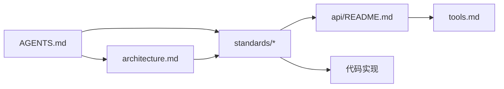

# 规范总则

> 状态：Stable ｜ 适用版本：v0.1.0 ｜ 最后更新：2026-10-27

本篇是规范体系的入口，说明规范的组织方式、约束强度与用语约定。

---

## 1. 规范清单

| 编号 | 主题 | 面向 |
| --- | --- | --- |
| [00-intro.md](00-intro.md) | 规范总则（本文） | 所有人 |
| [01-frontend.md](01-frontend.md) | 前端规范 | 前端 |
| [02-backend.md](02-backend.md) | 后端规范 | 后端 |
| [03-crypto.md](03-crypto.md) | 密码学与资源生命周期规范 | 后端 |
| [04-errors.md](04-errors.md) | 错误处理规范 | 全栈 |
| [05-testing.md](05-testing.md) | 测试规范 | 全栈 |
| [06-security.md](06-security.md) | 安全规范 | 全栈 |
| [07-observability.md](07-observability.md) | 可观测性规范 | 后端 / 运维 |
| [08-deploy.md](08-deploy.md) | 构建与部署规范 | 运维 / 后端 |
| [09-docs.md](09-docs.md) | 文档规范 | 所有人 |
| [10-git.md](10-git.md) | Git 与版本规范 | 贡献者 |

---

## 2. 用语约定

本文档集采用 [RFC 2119](https://www.rfc-editor.org/rfc/rfc2119) 的关键字：

- **必须（MUST）** / **禁止（MUST NOT）**：硬性要求，违反即阻断合并；
- **应当（SHOULD）** / **不应当（SHOULD NOT）**：默认要求，偏离时需在 PR 中说明理由；
- **可以（MAY）**：可选做法。

「必须」条款由自动化检查覆盖的，会在 CI 中强制执行。

---

## 3. 约束强度分层

| 层级 | 含义 | 校验方式 |
| --- | --- | --- |
| **硬约束** | 违反即缺陷，不接受「先这样以后改」 | CI 自动检查或代码评审直接打回 |
| **默认约定** | 允许偏离，需在 PR 描述中写明理由 | 评审时判断 |
| **建议** | 经验之谈，可自由取舍 | 不校验 |

标记方式：规范条目中的 **必须** / **禁止** 为硬约束；**应当** 为默认约定；未加限定词的描述性文字为建议。

---

## 4. 文档状态

每篇文档第二行是状态行：

```markdown
> 状态：Draft | Stable ｜ 适用版本：vX.Y.Z ｜ 最后更新：YYYY-MM-DD
```

| 状态 | 含义 |
| --- | --- |
| `Draft` | 内容仍在讨论，允许大幅调整，**不可作为实现依据** |
| `Stable` | 已冻结，实现必须遵循；变更需走 PR 评审 |
| `Deprecated` | 已废弃，保留仅为历史参考 |

---

## 5. 规范之间的关系



- `AGENTS.md` 是**入口**，列出必须遵守的不变量与禁止项；
- `architecture.md` 描述**结构与决策**；
- `standards/*` 描述**怎么写**；
- `api/*` 与 `tools.md` 描述**对外行为**。

冲突时优先级：`AGENTS.md` 不变量 > `architecture.md` 决策 > `standards/*` > `api/*`。

---

## 6. 变更规范

- 规范变更必须与对应代码变更**在同一个 PR** 中；
- 放宽任何 **必须** 条款需在 PR 描述中说明动机与替代保障措施；
- 新增规范条目需同步更新本篇的清单表；
- 规范变更后需检查 `AGENTS.md` 的不变量清单是否需要同步。

---

## 7. 快速索引

| 我要…… | 看这里 |
| --- | --- |
| 加一个工具 | [AGENTS.md §8](../../AGENTS.md)、[05-testing.md](05-testing.md) |
| 写前端组件 | [01-frontend.md](01-frontend.md) |
| 写 handler | [02-backend.md](02-backend.md)、[04-errors.md](04-errors.md) |
| 调密码学 | [03-crypto.md](03-crypto.md) |
| 加一个错误码 | [04-errors.md](04-errors.md) |
| 改 Dockerfile | [08-deploy.md](08-deploy.md) |
| 改环境变量 | [08-deploy.md](08-deploy.md) |
| 写文档 | [09-docs.md](09-docs.md) |
| 提交代码 | [10-git.md](10-git.md) |
