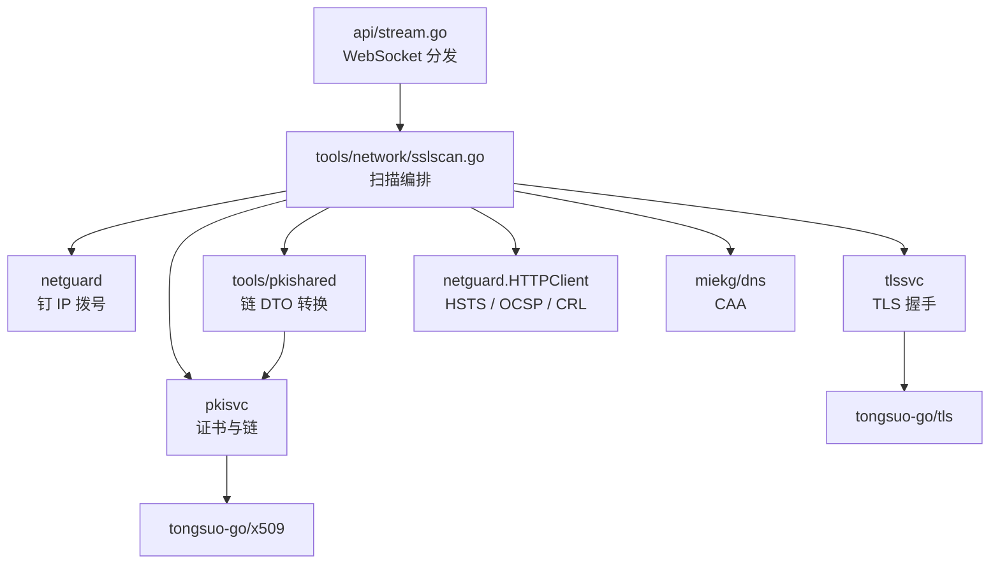

# SSL 证书检测（`ssl-check`）重构设计

> 状态：Draft ｜ 适用版本：v0.11.0 ｜ 最后更新：2026-11-06

本文是 `ssl-check` 从「单次 TLS 握手 + 6 项检查」重构为「协议 / 套件矩阵 + 特性探测 +
客户端握手模拟 + 全量证书链分析 + 四象限评级」的设计记录。**面向贡献者**，用户侧说明见
[docs/tools.md](../tools.md)，接口契约见 [docs/api/tools/network.md](../api/tools/network.md)。

---

## 1. 背景与目标

### 1.1 现状

当前实现（`backend/internal/tools/network/sslcheck.go`）用 Go `crypto/tls` 完成**一次**握手，
输出协商版本、套件、证书链、链验证结论与 6 项检查的简化评分。

四个明确短板：

1. **只测一个客户端视角**。一次握手只能看到「服务端与 Go 默认配置的交集」，
   无法回答「TLS 1.1 是否还开着」「这个套件是否还能协商」「老版浏览器能否连上」。
2. **证书信息浅**。链上每张证书只取 4 个字段（subject / issuer / validity / selfSigned），
   没有角色、连接诊断、扩展、指纹、公钥展开视图。
3. **评级不可解释**。6 项检查共用一个 100 分池，任意一项致命即 `T`，
   无法区分「协议落后」与「证书算法弱」这两类完全不同的风险。
4. **引擎不合规**。用 Go 标准库 `crypto/tls` 在工具层做握手，与
   [AGENTS.md](../../AGENTS.md) §4.15「密码学运算一律经 `cryptosvc` / `pkisvc` 转调 Tongsuo」不符。

### 1.2 目标

- 用 **Tongsuo** 作为唯一的 TLS 引擎，覆盖 TLS 1.0 / 1.1 / 1.2 / 1.3 的逐版本、逐套件探测。
- 证书链分析**与 `cert-chain-parse` 输出同构**，前端复用 `<CertChainTable>`，不再各写一套。
- 提供**客户端握手模拟**：以真实客户端的参数画像逐档握手，给出「支持 / 不支持 / 原因」。
- 评级改为**四象限**模型（证书 / 协议 / 密钥交换 / 加密强度），并给出档位上限规则。
- 明确划出**能力天花板**：不可测的项一律显式呈现为 `unavailable`，不静默省略、不猜测。

### 1.3 非目标

- **不做**与 SSL Labs 分数等价的对标。评级只反映**本次观测**的四个象限，不是站点整体安全评分。
- **不做**主动畸形探测（Heartbleed / ROBOT / CCS-Injection / POODLE / Ticketbleed）：
  需要构造非法握手报文，与「不自行拼装密码学」的红线冲突。见 §13。
- **不做** SSLv2 / SSLv3 探测：Tongsuo 基于 OpenSSL 3.x 兼容层，协议本身已被移除。
- **不做**前端密码学运算，扫描全部在服务端完成。

---

## 2. 与 SSL Labs 的能力对照

| 能力 | SSL Labs | 本工具 | 说明 |
| --- | --- | --- | --- |
| TLS 1.0 / 1.1 / 1.2 / 1.3 支持判定 | ✅ | ✅ | 逐档独立握手 |
| SSL 2.0 / 3.0 支持判定 | ✅ | ❌ | OpenSSL 3.x 已移除该协议，**不可实现** |
| 逐版本套件枚举与逐套件探测 | ✅ | ✅ | `tlssvc.EnumerateCipherSuites` + 逐项握手 |
| RC4 / EXPORT / 单 DES 类遗留套件 | ✅ | ⚠️ | 取决于 Tongsuo 构建是否启用 legacy provider，运行时探测，不可用则标 `unavailable` |
| 密钥交换组与强度 | ✅ | ✅ | `ConnectionState.NegotiatedGroup` |
| 对端握手签名算法 | ✅ | ✅ | `ConnectionState.PeerSignatureAlgorithm` |
| ALPN / HTTP/2 支持 | ✅ | ✅ | 客户端提供 `h2`、`http/1.1`，读协商结果 |
| 会话恢复 | ✅ | ⏳ | v0.9.0 未暴露复用标志，先标 `unavailable`，见 §13 |
| OCSP 装订（是否携带 + 响应内容） | ✅ | ⏳ / ✅ | 装订**是否携带**需上游 API；**主动 OCSP 查询**本版已实现 |
| SCT（证书透明度） | ✅ | ⏳ | TLS 扩展形式需上游 API；证书内嵌 SCT 可从扩展读取 |
| HSTS / CAA | ✅ | ✅ | 出网 HTTP + DNS |
| 吊销检查（OCSP + CRL） | ✅ | ✅ | AIA / CDP 出网 |
| 客户端握手模拟 | ✅ 真实 ClientHello 回放 | ⚠️ 参数近似 | 见 §8 的保真度说明 |
| 主动漏洞探测（5 类） | ✅ | ❌ | 见 §13 |
| 证书链完整分析 | ✅ | ✅ | 与 `cert-chain-parse` 同构 |

> `✅` 覆盖 · `⚠️` 部分覆盖 · `⏳` 待上游 · `❌` 不覆盖

---

## 3. 架构



### 3.1 新增包 `backend/internal/tlssvc`

Tongsuo 的 import 白名单从两个包扩为三个：

| 包 | 职责 | 是否拨号 |
| --- | --- | --- |
| `cryptosvc` | 密码学**原语**（摘要 / MAC / 对称 / 非对称） | 否 |
| `pkisvc` | 密钥与 **PKI**（格式、X.509、JWK、PKCS 容器） | 否 |
| `tlssvc` | **传输层**：TLS / NTLS 客户端握手与状态快照 | **否** |

`tlssvc` **只接受已经建立好的 `net.Conn`**，不解析主机名、不拨号、不做私网校验 ——
出网防护仍完全由 `netguard` 负责。这样「SSRF 防护」只有一处实现。

对外接口（示意，非最终签名）：

- `Handshake(ctx, raw net.Conn, opts Options) (State, error)` —— 包装已有连接并完成握手；
- `EnumerateCipherSuites(version uint16) []Suite` —— 枚举某协议版本下可用套件；
- `ClientProfiles() []Profile` —— 内置客户端画像（见 §8）；
- `State` —— 不含原生句柄的值快照（版本、套件、组、ALPN、对端签名算法、证书 DER、验证结论）。

> `State` 里**只有** DER / 字符串 / 枚举，不出现 `tongsuo-go` 类型，符合
> [03-crypto.md](../standards/03-crypto.md) 的「公开签名不出现上游类型」约定。

### 3.2 依赖方向

```text
api → tools → { cryptosvc, pkisvc, tlssvc } → tongsuo-go
                tools/pkishared → pkisvc
```

`tlssvc` 不反向依赖 `tools` 或 `api`；`tools/network` 是唯一同时使用 `netguard` + `tlssvc` 的地方。

### 3.3 文件划分（`tools/network/`）

| 文件 | 职责 |
| --- | --- |
| `tlsprobe.go` | 从 `sslcheck.go` 抽出的**底层**握手（`cert-chain-fetch` 继续复用） |
| `sslscan.go` | `ScanOptions` / `ScanResult` / `ScanTLS` 总编排与进度事件 |
| `sslscan_protocol.go` | 协议版本矩阵 |
| `sslscan_cipher.go` | 套件枚举、分级表、逐套件探测 |
| `sslscan_features.go` | ALPN、会话恢复、装订、重协商/压缩（不可测项标注） |
| `sslscan_clients.go` | 客户端画像表与逐档模拟 |
| `sslscan_cert.go` | 链解析、AIA / CDP 提取、吊销检查、must-staple、SCT 计数 |
| `sslgrade.go` | 四象限评分与档位上限 |

---

## 4. 依赖变更：`tongsuo-go` v0.9.0

### 4.1 为什么必须升级

`v0.5.0` 的 `tls` 包只有 `DialContext`（自行拨号，会绕过 `netguard` 的钉 IP）与
`Version()` / `CipherName()` / `PeerCertificates()` 三个访问器，不足以支撑矩阵扫描。

`v0.9.0` 补上了三块关键能力：

| 能力 | v0.9.0 | 对重构的意义 |
| --- | --- | --- |
| `tls.Client(raw net.Conn, cfg)` | ✅ | 包装 `netguard` 拨好的连接，SSRF 防护不破 |
| `Conn.ConnectionState()` 快照 | ✅ | 版本 / 套件 / ALPN / 组 / 对端签名算法 / 证书 DER / 验证结论，**握手失败后仍可读** |
| `Config.CipherSuites` / `CurvePreferences` / `SignatureAlgorithms` / `NextProtos` | ✅ | 精确裁剪，TLS 1.3 套件可单独探测 |
| `Verification` = `VerifyNone` / `VerifyReport` / `VerifyStrict` | ✅ | 探测用 `VerifyReport`：失败不中断握手，但保留失败码 |

### 4.2 升级影响面

`v0.5.0 → v0.9.0` 跨 4 个 MINOR，已知破坏点：

| 变更 | 影响 | 处置 |
| --- | --- | --- |
| `ecdh.PrivateKey.Public()` 返回 `(*PublicKey, error)` | `cryptosvc/ecdh.go` | 补错误处理与 `Close` |
| `x509.Name.Add` 改为**追加**（原为插到头部） | 多 RDN 的 DN 构造顺序变化 → 证书 DER 变化 | 生成夹具与契约数据可能需重生成；逐项比对 |
| `sym.Options.Padding` 对所有分组模式生效 | `cryptosvc/sym.go` 的拦截表可能过时 | 改为调用 `sym.Supports` / `sym.Paddings` |
| `x509` 对象签名后不可变 | `pkisvc/certgen.go` 等 | 确认无「先签名再加扩展」的路径 |
| `HandshakeError` / `Config` 新增字段 | keyed literal | 编译期报错即可发现 |

### 4.3 失败即回退

若升级导致大面积夹具重生成或无法收敛，**回退到「Go 引擎 + 逐项标注不可测」**方案：
`tlssvc` 保留接口，内部实现改为 Go `crypto/tls`，`protocols` / `ciphers` 中无法裁剪的项
（TLS 1.3 逐套件、legacy provider 套件）标 `unavailable`。评级模型与 API 契约不受影响。

---

## 5. 结果结构

WebSocket `result` 帧的 `data`（下列字段全部**恒存在**，数组恒为 `[]` 而非 `null`）：

| 字段 | 类型 | 说明 |
| --- | --- | --- |
| `endpoint` | object | `{ host, port, sni, addr, elapsedMs }` |
| `negotiated` | object | `{ version, cipher, cipherId, keyExchangeGroup, peerSignatureAlgorithm, alpn }` |
| `certificate` | object | 叶证书摘要（见 §5.2） |
| `chain` | object | **与 `cert-chain-parse` 的响应同构**（`ChainInfo`：`count` / `chain[]` / `ordered` / `missingRoot` / `selfSigned`） |
| `protocols` | array | `[{ version, supported, negotiatedCipher?, error? }]` |
| `ciphers` | array | `[{ version, name, id, family, bits, kex, verdict }]`，`verdict` ∈ `supported` \| `rejected` \| `unavailable` |
| `features` | array | `[{ id, label, status, detail? }]`，`status` ∈ `supported` \| `not_supported` \| `unavailable` |
| `clients` | array | `[{ id, vendor, os, engine, version, supported, reason?, version?, cipher?, alpn? }]` |
| `caa` | object | `{ queried, records[], permitted, violated }` |
| `revocation` | object | `{ ocspStapled, ocsp[], crl[] }`，每项 `{ url, status, thisUpdate?, nextUpdate?, error? }` |
| `hsts` | object | `{ present, maxAge, includeSubDomains, preload, error? }` |
| `grade` | object | `{ letter, score, categories, caps[], issues[] }`（见 §10） |
| `warnings` | array | 沿用现有 `toolerr.Warning` 信封 |

### 5.1 稳定标识

`features[].id`、`clients[].id`、`grade.categories` 的键、`grade.caps[]` 的取值都是**稳定标识**，
前端 i18n 直接以它们为 key，服务端**不**下发本地化文案。`label` 仅作兜底与调试。

`features[].id` 取值：

| `id` | 含义 | 判定方式 |
| --- | --- | --- |
| `alpnH2` | 支持 HTTP/2 | 提供 `h2,http/1.1`，读 `NegotiatedProtocol` |
| `sessionResumption` | 支持会话恢复 | 同一 ClientSessionCache 连续两次握手 |
| `ocspStapling` | 携带 OCSP 装订响应 | 依赖上游，见 §13 |
| `secureRenegotiation` | 安全重协商（RFC 5746） | 依赖上游 |
| `compression` | TLS 层压缩（CRIME 面） | 依赖上游 |
| `mustStaple` | 证书声明 must-staple | 读证书扩展 |

前 3 项之外的项在当前版本**恒为** `unavailable` 并带 `detail` 说明原因，
绝不返回「不支持」——「没测到」与「不支持」是两种结论。

### 5.2 `certificate` 摘要字段

| 字段 | 说明 |
| --- | --- |
| `subject` / `issuer` | 单行 DN 文本 |
| `serial` | 大写十六进制 |
| `notBefore` / `notAfter` | RFC 3339 |
| `daysRemaining` | 小数天数（与 `cert-chain-parse` 的 `validity.daysRemaining` 一致） |
| `keyAlgorithm` / `keyBits` / `curve` | 公钥画像 |
| `signatureAlgorithm` | 证书签名算法短名 |
| `sanCount` / `sanMatchesHost` | SAN 覆盖与主机名匹配 |
| `isCa` / `selfSigned` | 布尔 |
| `sctCount` | 证书内嵌 SCT 数量 |

---

## 6. WebSocket 帧协议

端点为 `GET /api/v1/tools/ssl-check/stream`（沿用现有路径，协议约定见
[api/README.md §11](../api/README.md)）。

### 6.1 客户端首帧

| 字段 | 类型 | 必填 | 说明 |
| --- | --- | --- | --- |
| `host` | string | 是 | 目标主机 |
| `port` | int | 否 | 默认 `443` |
| `sni` | string | 否 | 缺省用 `host` |
| `depth` | int | 否 | 链深度上限，默认 `5`，最大 `10` |
| `mode` | string | 否 | `quick` \| `full`，默认 `full` |
| `checks` | array | 否 | 缺省全开；可选 `protocols` `ciphers` `features` `clients` `cert` `revocation` `caa` `hsts` |
| `clients` | array | 否 | 客户端画像 id 列表；缺省用内置全部 |
| `budgetMs` | int | 否 | 总预算，默认 `60000`，上限 `180000` |

`mode: quick` 等价于 `checks: ["protocols","cert"]`，用于「只看一眼」的场景。
`checks` 中出现未知标识返回 `INVALID_FIELD`，**不**静默忽略。

### 6.2 服务端帧

| `type` | 载荷 |
| --- | --- |
| `progress` | `{ phase, done, total, item?, detail? }` |
| `result` | `{ data }` |
| `error` | `{ error: { code, message, params } }` |

`phase` 取值与顺序：

```text
resolve → connect → handshake → certificate → protocols → ciphers
        → features → clients → revocation → grade
```

- `total` 按本次实际启用的检查动态计算，**不**恒为固定值（与旧版 `total: 4` 不兼容）。
- `item` 只在 `ciphers` / `clients` 阶段出现，表示当前正在探测的套件名或画像 id。
- 进度帧节流：同一阶段内相邻帧间隔小于 100 ms 时合并，避免慢速站点刷出上百帧。

### 6.3 关闭码

`1000` 正常、`1008` 输入非法或被策略拒绝、`1011` 服务端内部错误、`1013` 预算耗尽（超时）。

---

## 7. 探测矩阵

### 7.1 协议版本

四档独立探测，每档固定 `MinVersion = MaxVersion = 目标版本`：

| 顺序 | 版本 | 常量 |
| --- | --- | --- |
| 1 | TLS 1.3 | `0x0304` |
| 2 | TLS 1.2 | `0x0303` |
| 3 | TLS 1.1 | `0x0302` |
| 4 | TLS 1.0 | `0x0301` |

`SSLv3`（`0x0300`）不入矩阵：OpenSSL 3.x 无该协议，返回 `unavailable` 并在文档标注。

### 7.2 套件

1. 对每个**受支持**的协议版本调用 `EnumerateCipherSuites(version)` 取全量；
2. 与内置**分级表**（`sslscan_cipher.go` 的静态表：族 / 强度位 / 是否 AEAD / 是否遗留）求交；
3. 按「强 → 弱」排序后逐项探测，**上限 40 项/版本**，超出部分只列举不探测；
4. 单项探测固定 `CipherSuites = [该套件]`，握手成功即 `supported`。

优先级：TLS 1.3 套件全部探测（数量少）；TLS 1.2 取 ECDHE-AEAD、ECDHE-CBC、DHE、RSA 各族的代表项；
TLS 1.0 / 1.1 只探测「是否会因为遗留套件而被整体降级」。

> TLS 1.3 的套件由 `set_ciphersuites` 精确控制，**可以**逐项探测；
> 这一点 Go 标准库做不到，是切换 Tongsuo 的直接收益之一。

### 7.3 探测次数预算

| 阶段 | 上限 |
| --- | --- |
| 协议 | 4 |
| 套件 | 40 × 受支持版本数（实际按 §7.2 压缩到 ~30） |
| 特性 | 3（ALPN + 会话恢复 2 次） |
| 客户端模拟 | 画像数（默认 12） |
| 出网附加 | 5（HSTS 1 + OCSP ≤2 + CRL ≤2） |
| 合计 | **≈ 50 次握手 + 5 次 HTTP** |

---

## 8. 握手模拟

### 8.1 保真度声明

**这是参数级近似，不是 ClientHello 字节回放。** 差异来源：扩展顺序、GREASE 填充、
TLS 指纹细节、以及各浏览器私有的非标准行为。

因此结论的措辞是「**以该客户端画像的参数发起握手，服务端是否接受**」，
而不是「该浏览器一定能/不能访问」。工具页与 API 文档都要写这句话。

### 8.2 画像表

画像字段：`id`、`vendor`、`os`、`engine`、`version`、`minVersion`、`maxVersion`、
`cipherSuites`、`curves`、`signatureAlgorithms`、`nextProtos`。

| `id` | 画像 | 协议范围 | 备注 |
| --- | --- | --- | --- |
| `chrome` | Chrome / Windows 10+ | 1.2–1.3 | 现代 AEAD 套件集 + X25519 |
| `firefox` | Firefox | 1.2–1.3 | 与 Chrome 套件集略有差异 |
| `safari` | Safari / macOS | 1.2–1.3 | 含 `ECDHE-ECDSA` 偏好 |
| `edge` | Edge / Chromium | 1.2–1.3 | 同 Chrome |
| `android` | Android 10+ | 1.2–1.3 | — |
| `ios` | iOS 16+ | 1.2–1.3 | — |
| `java11` | Java 11 | 1.2–1.3 | — |
| `java8` | Java 8 | 1.2 | 不含 TLS 1.3，常见于老旧中间件 |
| `openssl111` | OpenSSL 1.1.1 | 1.0–1.3 | 遗留兼容基线 |
| `openssl3` | OpenSSL 3.x | 1.2–1.3 | — |
| `schannel` | Windows Schannel | 1.2 | 只做 TLS 1.2，验证 CBC 套件兼容 |
| `go` | Go `crypto/tls` 默认 | 1.2–1.3 | 与本服务端自身栈的兼容性参照 |

### 8.3 失败归因

`reason` 取值稳定，前端按 key 本地化：

| `reason` | 含义 |
| --- | --- |
| `noCommonVersion` | 无交集协议版本 |
| `noCommonCipher` | 无交集套件 |
| `noCommonGroup` | 无交集密钥交换组 |
| `noCommonSigAlg` | 无交集签名算法 |
| `handshakeFailure` | 服务端主动拒绝（alert） |
| `network` | 建连 / 超时失败 |

**归因靠「逐步放宽」的对照握手，而不是匹配错误文本**：

1. 只保留画像的版本范围（其余维度用默认）→ 失败即 `noCommonVersion`；
2. 版本范围 + 画像套件 → 失败即 `noCommonCipher`；
3. 版本范围 + 画像密钥交换组 → 失败即 `noCommonGroup`；
4. 以上都通过 → `handshakeFailure`。

同理，协议矩阵与套件矩阵的结论也都是**对照**得出的：

- 套件探测只在**已确认支持**的版本上进行（该版本刚用默认套件握手成功），
  唯一的变量是套件，因此「单套件握手失败」= 服务端不接受该套件；
- 协议版本逐档锁定 `MinVersion == MaxVersion`，
  失败即该版本不可用。

> 这套做法绕开了上游的一个已知缺陷：握手错误分类在**错误线程**上取原生错误队列
> （见 [upstream/tongsuo-go-issues.md](../upstream/tongsuo-go-issues.md) I-28），
> 因此**不能**依赖上游的 `HandshakeError.Kind` 做结论。

---

## 9. 证书与链分析

### 9.1 复用策略

链分析**不另写一套**：

| 步骤 | 实现 |
| --- | --- |
| 解析服务端证书 | `pkisvc.ParseCertificates`（DER 列表） |
| 排序 + 角色 + 连接诊断 + 有效期 + 指纹 + 公钥展开 | `pkisvc.OrderChain` |
| 输出 DTO 转换 | 新增 `tools/pkishared`，`tools/pki` 与 `tools/network` 共用 |
| 前端渲染 | `<CertChainTable>` + `<CertExtensions>` + `@/types/certificate` |

`tools/pkishared` 承接原 `tools/pki/dto.go` 中的 `CertInfoOutput` / `ChainLinkOutput` /
`ValidityOutput` / `PublicKeyDetailOutput` / `FingerprintOutput` 及其转换函数，
**转换逻辑零改动**，保证 `cert-chain-parse` 的输出字节不变。

### 9.2 链之外补的三件事

| 项目 | 来源 | 说明 |
| --- | --- | --- |
| AIA（`caIssuers`） | 证书扩展 | 缺失的中间证书可从该 URL 补齐后再验一次链 |
| CDP（`crlDistributionPoints`） | 证书扩展 | 供 §9.3 下载 CRL |
| 吊销与 must-staple | 装订响应 / OCSP 查询 / CRL | 见 §9.3 |

### 9.3 吊销检查

按代价递增依次尝试，**任一步成功即止**：

1. **OCSP 装订**：若 `features.ocspStapling` 为 `supported`，解析装订响应（复用 `pkisvc` 的 OCSP 解析）；
2. **主动 OCSP**：向叶证书 AIA 的 `ocsp` URL 发 `POST`（经 `netguard.HTTPClient`，限 4 MiB、不跟随重定向）；
3. **CRL**：下载 CDP 中的 CRL 并解析（经 `netguard.HTTPClient`，限 8 MiB）。

结论三态：`good` / `revoked` / `unknown`（含失败原因）。**超时或网络失败不得判 `revoked`**。

### 9.4 CAA

父域与主域各查一次 `CAA` 记录，与链尾签发者的域名比对，输出 `permitted` / `violated`。
无 CAA 记录不算违规。

---

## 10. 评级模型

### 10.1 四象限

各象限满分 100，**互不抵扣**：

| 象限 | 权重项 | 规则 |
| --- | --- | --- |
| `certificate` | 链可信 40 / 主机名 20 / 有效期 15 / 密钥强度 15 / 签名算法 10 | 不可信或主机名不匹配 → 0 分并触发上限 |
| `protocols` | 取最高支持档 | TLS 1.3 → 100，TLS 1.2 → 90，TLS 1.1 → 20，TLS 1.0 → 20 |
| `keyExchange` | 协商组强度 | X25519 / P-256+ → 100；DHE < 2048 → 20；RSA 密钥交换 → 20；HSTS 命中 +5（封顶 100） |
| `cipherStrength` | 协商套件 | AEAD → 100；CBC → 80；RC4 / 3DES / 单 DES → 20 |

### 10.2 档位上限

按下列顺序求最严上限：

| 条件 | 上限 |
| --- | --- |
| 证书不可信（链无法追溯到信任根） | `T` |
| 主机名不匹配 | `M` |
| 只支持 TLS 1.0 / 1.1 | `B` |
| 不支持 TLS 1.3 | `A` |
| 存在 `revoked` | `F` |
| 以上都不命中 | `A+` |

字母顺序：`A+ > A > A- > B > C > D > E > F > M > T`。
最终等级 = min(分数映射等级, 上限等级)。

### 10.3 `unavailable` 的处理

任何 `unavailable` 的检查项**不参与计分**，也不触发上限，但必须出现在 `grade.issues` 里，
并带 `impact: "unknown"`。评分页要显示「本次有 N 项未能测出」，
否则用户会把「没测」误读为「没问题」。

### 10.4 与旧评级的差异

旧版 6 项检查的 A+/A/B/C/T 与新版**不保证一致**，属于破坏性变更（见 §14）。

---

## 11. 超时、并发与预算

| 参数 | 值 | 说明 |
| --- | --- | --- |
| 单次握手超时 | 5 s | 单项探测 |
| 单次出网请求超时 | 6 s | HSTS / OCSP / CRL |
| 阶段内并发 | 4 | 同一阶段内的探测并行，阶段间串行 |
| 总预算 | 默认 60 s，上限 180 s | 由 `budgetMs` 控制，超时以 `1013` 关闭 |
| 流式会话总预算 | 180 s | `stream.go` 的 `streamBudget` |
| 首帧等待 | 5 s | 不变 |
| 心跳 | 30 s | 不变 |

并发上限 4 是为了兼顾速度与对目标站点的礼貌性；同一目标 IP 的连接仍受 `netguard` 约束。

---

## 12. 出网与 SSRF

- 所有建连统一走 `netguard.DialTCP`：**一次解析**，私有 / 环回 / 链路本地地址一律拒绝，
  后续 50 次握手复用同一个已校验 IP，避免 DNS rebinding。
- 所有 HTTP 出网走 `netguard.HTTPClient`：禁用环境代理、逐跳重定向校验（≤3）、响应体上限。
- OCSP / CRL / AIA 的 URL 同样是**用户可控的间接输入**（来自对端证书），必须同样过 `netguard`。
- 响应中**不回显**用户输入；错误信息只带字段名与枚举值。

---

## 13. 上游缺口台账

新增条目（格式同 [upstream/tongsuo-go-issues.md](../upstream/tongsuo-go-issues.md)）：

| 编号 | 缺口 | 影响 | 本版处置 |
| --- | --- | --- | --- |
| I-23 | `ConnectionState` 不含 OCSP 装订响应原文 | `features.ocspStapling`、吊销第 1 步 | 标 `unavailable`，改用主动 OCSP |
| I-24 | `ConnectionState` 不含 SCT 列表（`signed_certificate_timestamp`） | 透明度校验 | 只读证书内嵌 SCT |
| I-25 | 无「会话已复用」标志，`Config` 无 ticket / session 控制 | `features.sessionResumption` | 标 `unavailable`（上游排期 0.10–0.12） |
| I-26 | 不暴露 secure renegotiation / 压缩 / heartbeat 状态 | 3 项特性 | 标 `unavailable` |
| I-27 | 无裸握手 / 心跳探测入口 | Heartbleed / ROBOT / CCS / POODLE / Ticketbleed | **不做**，文档写明原因 |
| I-28 | 握手错误分类在**错误线程**上取原生错误队列 | 失败归因 | 不依赖它；改用「逐步放宽」的对照握手 |

> I-27 与 [AGENTS.md](../../AGENTS.md) §4.15 / §5 的红线直接相关：
> 自研 TLS 报文构造等于自行拼装密码学，禁止。缺口只能走上游。

---

## 14. 破坏性变更与迁移

| 变更 | 影响面 | 迁移 |
| --- | --- | --- |
| `result.data` 整体换结构 | `ssl-check` 前端、契约测试 | 前端重写结果区 |
| 首帧新增 `mode` / `checks` / `clients` / `budgetMs` | 前端、`docs/api/tools/network.md` | 老首帧仍可用（全部有默认值） |
| `progress.total` 不再恒为 4 | 前端进度条 | 按 `total` 动态渲染 |
| 评级规则变化 | 用户预期 | `CHANGELOG.md` 明确标注 |
| `network.TLSChainCert` 的 `info` 换成 `pkishared` 的 `CertInfoOutput` | `cert-chain-fetch` 契约 | 同步更新契约数据与文档 |
| `tools/pki/dto.go` 的 DTO 迁到 `tools/pkishared` | 仅内部 | 包内引用调整 |

`ssl-check` 与 `cert-chain-fetch` 均未发布过正式契约，因此不保留兼容别名。

---

## 15. 测试与验证清单

### 15.1 单元测试

- 评级模型：表驱动覆盖四象限、六条上限、`unavailable` 不参与计分。
- 套件分级表：每项名称必须能被 `tlssvc.EnumerateCipherSuites` 解析出（否则启动期失败）。
- 客户端画像：同上，且 `minVersion ≤ maxVersion`。
- CAA / HSTS / OCSP / CRL 解析函数：正常 + 畸形输入。

### 15.2 集成测试

用 `tlssvc` 的服务端能力起本地回环，配自签证书，覆盖三个场景：

| 场景 | 断言 |
| --- | --- |
| 仅支持 TLS 1.2 | `protocols` 中 1.3 为 `not_supported`、`grade` 封顶 `A` |
| 仅支持弱套件（CBC + SHA1） | `cipherStrength` 低分、`issues` 命中 |
| 自签名证书 | `certificate` 为 0、等级 `T`、警告 `SELF_SIGNED_CERT` |

### 15.3 契约与回归

- `backend/testdata/contract/ssl-check.json` 与 `cert-chain-fetch.json` 重生成。
- `backend/internal/api/api_test.go` 中 `ssl-check` 的 405 断言与工具总数不变。

### 15.4 提交前

1. `make verify`（含 `vet` / `test -race` / `lint` / 前端单测 / 构建 / 体积预算）；
2. `make check-docs`（新文档的状态行与 slug 覆盖）；
3. 手工对 `zotrus.com` 跑一次全量扫描，与 `openssl s_client -connect` 逐项比对协议与套件。
